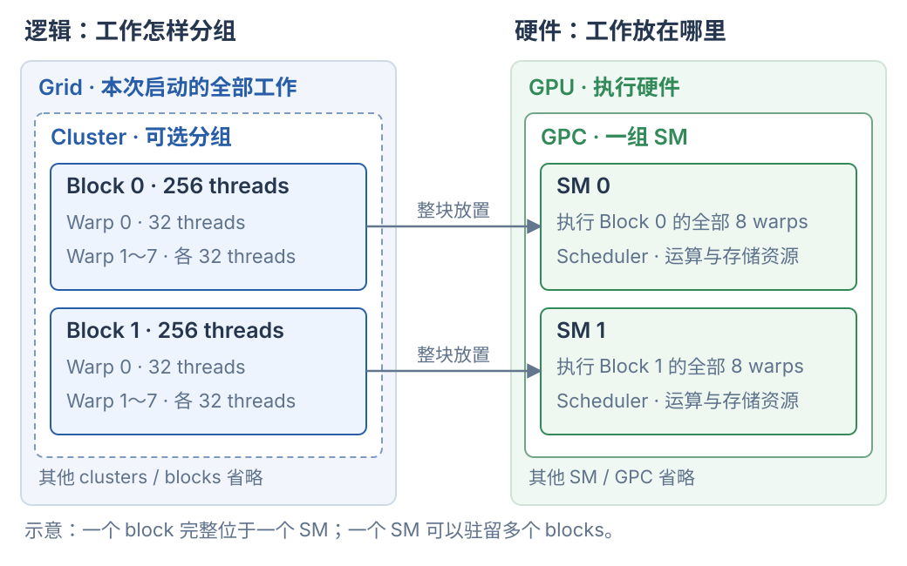

# CUDA 执行层级与硬件映射

一次 kernel 启动产生一个 grid；grid 包含 blocks，block 内的线程按每 32 个组成 warp。启用 thread block cluster 时，grid 里的若干 blocks 组成一个 cluster。**一个 block 的所有线程在同一个 SM 上执行；一个 SM 可以同时驻留多个 blocks。**

## 1. 工作分组与硬件位置

CUDA 中要分别看两套层级：一套描述程序怎样分工，一套描述承接这些工作的硬件。

| 视角 | 层级 | 表达什么 |
| --- | --- | --- |
| 逻辑工作 | Grid → Cluster（可选）→ Block → Warp → Thread | 本次计算包含哪些线程、怎样分组协作 |
| 硬件 | GPU → GPC → SM → 各类执行单元 | 工作放在哪里、由哪些硬件发出和执行指令 |

GPC 是 Graphics Processing Cluster，硬件上包含一组 SM。它与软件中的 thread block cluster 是两个不同对象。CUDA Core、Tensor Core 等位于 SM 内，是执行指令的硬件；线程没有永久独占某一个 Core。



图中只展开一个含两个 blocks 的 cluster，箭头表示一种可能的放置方式。每个 block 有 256 个线程，即 8 个 warps；cluster 内的 blocks 可以位于不同 SM，但仍受同一 GPC 的位置约束。图中每个 SM 只画一个 block，不代表 SM 只能驻留一个 block。

来源：[NVIDIA 编程模型：硬件、Blocks、Grids 与 Clusters](https://docs.nvidia.com/cuda/cuda-programming-guide/01-introduction/programming-model.html)。

## 2. 一次 launch 产生多少工作

先看一维启动。下面的 `kernel` 已在别处定义，`x`、`y` 是传入的设备指针；此处仅展示启动方式：

```cpp
kernel<<<12, 256>>>(x, y);
// 12 个 blocks，每个 block 256 个 threads
```

| 对象 | 本例数量与编号 |
| --- | --- |
| Grid | 1 个，包含这次启动的全部工作 |
| Block | 12 个，blockIdx.x 为 0～11 |
| 每个 block 的 threads | 256 个，threadIdx.x 为 0～255 |
| 每个 block 的 warps | 256 / 32 = 8 个 |
| 整个 grid 的 threads | 12 × 256 = 3072 个 |
| 整个 grid 的 warps | 12 × 8 = 96 个 |

一维情况下，常用下面的式子为每个线程分配数据位置：

```cpp
int i = blockIdx.x * blockDim.x + threadIdx.x;
// block 0：i = 0～255
// block 1：i = 256～511
// block 11：i = 2816～3071
```

这些数量描述**要执行多少工作**。它们没有指定 GPU 必须有 12 个 SM，也没有保证 12 个 blocks 同时运行。grid、block 也可以用二维或三维索引，便于把工作对应到数据坐标；索引维度本身不规定硬件放置。

## 3. Warp 是 block 内的执行分组

一个 block 的线程按线性编号连续分组，每组 32 个。对于上面的一维 256-thread block：

```text
Block
├── Warp 0：thread 0～31
├── Warp 1：thread 32～63
├── …
└── Warp 7：thread 224～255
```

lane 是线程在 warp 内的位置，编号 0～31。一维例子中可以用 `threadIdx.x % 32` 计算 lane 编号。若 block 的线程数不是 32 的整数倍，最后一个 warp 会有未使用的位置。

Warp 的 SIMT 执行让活跃线程对各自的数据执行同一条指令；线程各自保存寄存器等状态。同一 warp 中线程走不同分支时，某条路径的指令只由属于该路径的线程参与。不同 warps 可以独立推进；同一 warp 也不能据此省略程序所需的显式同步。

来源：[NVIDIA SIMT 与硬件多线程](https://docs.nvidia.com/cuda/cuda-programming-guide/03-advanced/advanced-kernel-programming.html#simt-execution-model)。

## 4. Block 完整放入一个 SM，SM 可容纳多个 blocks

一个 block 的所有 warps 都在同一个 SM 上执行。普通 CUDA 执行模型不会把一个 block 的一半线程放到 SM 0，另一半放到 SM 1。

假设有四个 256-thread blocks，资源允许时，一种可能的放置是：

```text
SM 0
├── Block 0：8 个 warps
└── Block 3：8 个 warps

SM 1
├── Block 1：8 个 warps
└── Block 2：8 个 warps
```

这里 SM 0 驻留了 16 个 warps，但不意味着它们每个时刻都在同时执行。SM 的 warp schedulers 从就绪的 warps 中选择指令，交给相应执行单元；有的 warp 可能正在等待访存或依赖结果。

**驻留表示工作状态已经占用 SM 资源；执行表示指令正在使用相应流水线。** 计算资源与存储资源都影响一个 SM 能容纳多少 blocks：

| SM 上的资源 | 与驻留工作的关系 |
| --- | --- |
| Registers | 保存线程状态与中间值；每个线程用得越多，整体资源压力越大 |
| Shared memory | 从 SM 的片上资源中分配给各 block；每个 block 的普通 shared memory 独立 |
| 线程、warp、block 数量上限 | 即使存储资源尚有空余，也受硬件驻留数量上限约束 |

两个 blocks 即使碰巧落在同一个 SM，也不会自动共享普通 `__shared__` 数组，`__syncthreads()` 仍只同步调用者所属的 block。程序不能依赖某两个普通 blocks 一定相邻、同时运行或按 block 编号顺序执行。

来源：[NVIDIA Hardware Multithreading](https://docs.nvidia.com/cuda/cuda-programming-guide/03-advanced/advanced-kernel-programming.html#hardware-multithreading)。

## 5. Cluster 把多个 blocks 组织到同一 GPC

启用 cluster 后，包含关系是：

```text
Grid：12 个 blocks
├── Cluster 0：Block 0～3
├── Cluster 1：Block 4～7
└── Cluster 2：Block 8～11
```

这是将一维 grid 配置成每个 cluster 4 个 blocks 后的逻辑例子：每个 cluster 有 4 × 256 = 1024 个线程、32 个 warps。前面的普通 `<<<12, 256>>>` 本身没有指定这种四块分组；需要额外使用 cluster 启动配置或相应 kernel 声明。

cluster 的价值是增加了**共同驻留和局部合作的保证**：其中的 blocks 在同一 GPC 内协同调度，可以跨 SM，并支持 cluster barrier 和 distributed shared memory。后者让 cluster 内的线程访问其他 block 的 shared memory，访问仍需遵守同步和存储生命周期要求。

| 范围 | 放置与协作约束 |
| --- | --- |
| Block | 所有线程在一个 SM；普通 shared memory 与 block barrier 的范围 |
| Cluster | 多个 blocks 共同驻留于同一 GPC 内；每个 block 仍完整位于一个 SM |
| Grid | 本次启动的全部 blocks；可跨多个 GPC，普通 grid 可分批执行 |

Thread block cluster 是 Compute Capability 9.0 起引入的可选分组能力；可用的 cluster 大小需要结合设备和配置检查。软件 cluster 与硬件 GPC 也不是一一对应关系，不能把一个 GPC 的全部 SM 默认看成“一个 cluster”。

来源：[NVIDIA Thread Block Clusters](https://docs.nvidia.com/cuda/cuda-programming-guide/01-introduction/programming-model.html#thread-block-clusters)。

## 6. Block barrier：先准备数据，再跨线程使用

下面的片段约定以一个 block、128 个线程启动，输入输出各有至少 128 个元素，且是不同数组。示例只说明同步语义，没有进行 CUDA 编译或运行。

```cpp
__global__ void reverse_block(const float* x, float* y) {
    __shared__ float tile[128];
    int t = threadIdx.x;

    tile[t] = x[t];           // 每个线程搬一个元素
    __syncthreads();          // 等所有参与线程写完，再允许后面的读取
    y[t] = tile[127 - t];     // 读取其他线程搬来的元素
}
```

thread 0 要读 thread 127 写入的 `tile[127]`。两者属于不同 warp；没有 barrier 时，thread 0 可能先读，而 thread 127 尚未写入。barrier 同时建立线程间的执行顺序和普通 shared memory 访问的可见性。

所有参与线程需要按一致的顺序到达对应 barrier。对于 128 个仍在运行的线程，把 `__syncthreads()` 放在仅 `threadIdx.x < 64` 进入的分支内，会造成不一致的参与，可能挂起或产生错误。barrier 也不等于自动等待另外发起的异步拷贝完成；异步操作需要相应的完成等待。

循环复用同一份 shared memory 时，还常需要第二次 barrier：

```text
加载本轮 tile
block barrier   ← 防止数据没准备好就读取
使用本轮 tile 计算
block barrier   ← 防止有人没读完就被下一轮覆盖
进入下一轮
```

来源：[NVIDIA Shared Memory](https://docs.nvidia.com/cuda/cuda-programming-guide/02-basics/writing-cuda-kernels.html#shared-memory)。

## 7. 更大范围的同步与 kernel 完成边界

| 需求 | 常用方式 | 等待范围与条件 |
| --- | --- | --- |
| Block 内线程集合 | `__syncthreads()` | 当前 block 的参与线程 |
| Cluster 内集合 | `cooperative_groups::this_cluster().sync()` | 当前 cluster，需要支持并配置 cluster |
| 同一 kernel 的全部线程集合 | `cooperative_groups::this_grid().sync()` | 当前 grid，要求合作式启动及资源限制 |
| 后一个 kernel 使用前一个的完整结果 | 同一 stream 中先后提交两个普通 kernel | 后一个在前一个完成后执行，CPU 不必等待 |
| 不同 streams 间建立依赖 | event record + stream wait event | 消费方 stream 的后续工作等待生产方事件 |
| CPU 等指定 stream | `cudaStreamSynchronize(stream)` | 调用的 CPU 线程等待该 stream 此前提交的工作 |
| CPU 等当前设备上下文的工作 | `cudaDeviceSynchronize()` | 调用的 CPU 线程等待此前提交的设备工作，不覆盖其他 GPU 或其他进程 |

`cluster.sync()` 是局部集合，`grid.sync()` 是整个 grid 的集合。普通 grid 的 blocks 可能需要排队，不能随意用全局计数器和自旋构造一个全 grid barrier：若已驻留的 blocks 占着资源等待，尚未调度的 blocks 可能一直无法运行。grid-wide 同步需要 `cudaLaunchCooperativeKernel` 等合作式启动，并满足相应能力和驻留资源条件。

更常见的阶段划分方式是先结束 kernel A，再执行 kernel B。下面 `phase_A`、`phase_B` 和 `stream` 已由调用方定义：

```cpp
phase_A<<<12, 256, 0, stream>>>(x, intermediate);
phase_B<<<12, 256, 0, stream>>>(intermediate, y);
// 同一 stream：A 的全部 blocks 完成后，B 才开始。
// CPU 可以把两次启动连续提交，无需在中间 cudaDeviceSynchronize()。
```

`__threadfence()` 则是内存顺序相关操作，不能用来要求所有 blocks 到达同一个位置。判断同步时，先明确是线程集合、内存顺序、GPU 工作依赖，还是 CPU 等待完成。

来源：[NVIDIA Cooperative Groups](https://docs.nvidia.com/cuda/cuda-programming-guide/04-special-topics/cooperative-groups.html)、[CUDA Streams 与 Events](https://docs.nvidia.com/cuda/cuda-programming-guide/02-basics/asynchronous-execution.html)。

## 8. 层级与数量容易混淆的地方

| 说法 | 应怎样理解 |
| --- | --- |
| “Block 分成 cluster 或 warp” | Cluster 包含 blocks；block 内的线程组成 warps |
| “12 个 blocks 需要 12 个 SM” | 一个 SM 可以驻留多个 blocks；blocks 也可以排队，数量不要求相等 |
| “一个 block 的 warps 可以分到不同 SM” | 同一 block 的所有线程在同一 SM |
| “驻留的线程都在同时算” | 驻留包含等待状态，指令由 scheduler 选择并发出 |
| “同一 SM 上的 blocks 自动共享 shared memory” | 普通 shared memory 按 block 隔离；cluster 的 distributed shared memory 是显式协作能力 |
| “一个 grid 就是一整张 GPU” | Grid 是一次启动的工作集合；GPU 是执行硬件，可执行多个 grid 的工作 |
| “Warp 对应一组永久专属 CUDA Cores” | Warp 是执行分组，指令使用共享的硬件流水线 |
| “Tile 是 block 与 warp 之间的线程层级” | Tile 是数据或计算区域；block/warp 是执行分组，具体实现决定谁处理哪个 tile |

## 9. 线程的计算、搬运与通信分工

计算、搬运和通信是程序安排给线程的工作角色。GPU 线程没有固定的“计算线程”或“搬运线程”硬件类型；同一个线程可以先搬数据，再计算，再写回结果。理解分工时，先看线程执行哪些指令，再看指令使用哪些硬件。

### 9.1 普通 global→shared 复制为什么经过寄存器

第 6 节的 `tile[t] = x[t]`，在普通 load/store 路径中可以拆成两步。下面是 kernel 内的片段，`x` 指向 global memory，`tile` 位于 shared memory：

```cpp
float tmp = x[t];  // 从 global memory 读取，通常由线程寄存器保存结果
tile[t] = tmp;     // 把寄存器中的值写入 shared memory
```

即使源码直接写成一句赋值，普通 load/store 路径仍需要寄存器承接读取结果。下面是指令语义示意，不是编译器输出：

```text
ld.global  r, [global_address]
st.shared  [shared_address], r

数据路径：global memory → 寄存器 r → shared memory
```

`st.shared` 使用 `ld.global` 的结果，因此存在数据依赖。这里的 global memory 是地址空间；读取可能命中缓存，不代表每次都访问 HBM。具体源码怎样生成指令，需要检查目标架构上的编译结果。

`cp.async` 同时指定源地址、目标地址和复制大小。支持的复制路径可以直接把数据送入 shared memory，省去被复制数据在普通寄存器中的中转：

```text
cp.async [shared_address], [global_address], 复制字节数

数据路径：global memory → shared memory
线程工作：计算地址 → 发起复制 → 做独立工作 → 等待完成 → 使用数据
```

**省去的是数据中转用的寄存器；地址、循环变量和同步状态仍可能占用寄存器。** 发起复制不代表数据已经可用。使用前需要对应的异步完成等待；跨线程使用时，还要建立所需的线程间同步。

减少寄存器中转和允许异步推进是两个收益。前者减少搬运数据所需的寄存器及相关指令；后者允许把等待推迟到真正需要数据时。普通 load 也不意味着整个 GPU 停住：调度器仍可让其他就绪 warps 执行。

来源：[CUDA 异步复制与 load/store 路径](https://docs.nvidia.com/cuda/cuda-programming-guide/04-special-topics/async-copies.html)、[PTX cp.async](https://docs.nvidia.com/cuda/parallel-thread-execution/index.html#data-movement-and-conversion-instructions-cp-async)。

### 9.2 所有线程轮流工作，或按 warp 固定分工

一种常见实现让 block 内的线程先共同加载，再共同计算：

```text
每个线程搬一部分输入
        ↓
同步，确认数据可用
        ↓
每个线程参与计算
        ↓
确认本轮数据已用完，再复用 buffer
```

此时每个线程都兼任搬运与计算，没有专门的搬运线程组。

另一种实现按 warp 安排不同角色，称为 **warp specialization**。负责准备数据的 producer warps 与负责使用数据的 consumer warps 可以独立推进：

```text
Producer warps：等空 buffer → 发起搬运 → 确认或安排完成通知 → 准备下一块
Consumer warps：等数据就绪 → 执行计算 → 通知 buffer 已用完 → 处理下一块
```

使用多个 buffer 时，producer 可以准备 tile 1，consumer 同时计算 tile 0。两者必须遵守两个条件：数据搬完才能读，消费者用完才能覆盖。按 warp 分工符合 warp 的执行分组；并不是把同一 warp 内的任意线程拆开，就能让不同路径自由并行。

Hopper 的 Tensor Memory Accelerator（TMA）适合这种分工：producer 中的一个线程可以提交整块数据的搬运请求，硬件继续传输。Producer 仍需管理请求和同步，但不必亲手逐元素复制。Warp specialization 是角色安排，双缓冲是存储安排，TMA 是搬运机制；三者可以组合使用。

来源：[Hopper TMA 与 warp specialization](https://docs.nvidia.com/cuda/hopper-tuning-guide/index.html#tensor-memory-accelerator)。矩阵乘法中的流水线可继续看 [GEMM 计算与优化](gemm.md)。

### 9.3 线程的角色与硬件执行单元

“线程负责计算或搬运”描述谁组织工作。实际指令还要交给相应硬件执行：

| 程序中的工作 | 线程负责什么 | 硬件承担什么 |
| --- | --- | --- |
| 普通算术 | 执行算术指令，维护操作数和结果 | 对应的算术流水线执行运算 |
| Tensor Core 计算 | 按指令要求协作，发起矩阵运算并管理依赖 | Tensor Core 执行矩阵运算 |
| 异步搬运 | 准备地址或 descriptor，发起请求，等待完成 | 对应的访存与搬运硬件传输数据 |
| 通信 | 按实现读取或写入 buffer、归约、等待或更新完成标记 | GPU 互联、内存系统或网卡承担实际传输 |

通信的流程取决于具体实现。一个通信线程可能等待数据就绪，读取数据并做 reduction，写入目标 buffer，再通知消费者。跨设备传输还可能由网卡或其他搬运引擎推进。“有通信线程”并不意味着全部数据都经过它的寄存器。

还要区分两种并行范围。同一 kernel 内，可以让不同 warps 分工。不同 kernels 之间，也可以安排计算 kernel 与通信 kernel 并发。后者取决于 stream 依赖和可用资源，提交到不同 streams 并不保证真正重叠。线程角色也不会为其永久保留某个 CUDA Core 或 Tensor Core。

来源：[NVIDIA SIMT 与硬件多线程](https://docs.nvidia.com/cuda/cuda-programming-guide/03-advanced/advanced-kernel-programming.html#simt-execution-model)、[CUDA 异步执行](https://docs.nvidia.com/cuda/cuda-programming-guide/02-basics/asynchronous-execution.html)。

本文的数量例子和放置图用于推导关系，不表示某个 GPU 型号的实测调度。CUDA 片段未做编译或实机验证；架构相关上限以目标设备和 NVIDIA 文档为准。Tensor 的 shape、stride 与存储关系可继续对照 [Tensor 与 GPU 内存](../PyTorch/tensors.md)。
