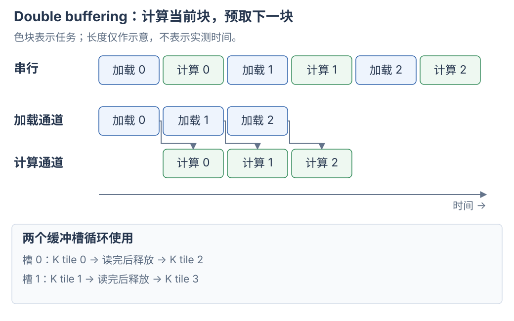

# GEMM：分块计算、数据搬运与常见优化

attention 怎样把两次 GEMM 与 softmax 接起来，并随 GPU 架构改变流水线，见 [FlashAttention 1–4](flash-attention.md)。

将这些机制用于具体模型与硬件的算量、流量和 TP 分析，见 [Qwen3-32B / H100 案例](../Attention/qwen3-h100-tp-case.md)。

## 1. 先固定矩阵与维度的含义

GEMM 是 General Matrix Multiplication，常见接口计算 $D=\alpha AB+\beta C$。其中 $\alpha$、$\beta$ 是标量，$C$ 是原有输入，$D$ 是新输出。先令 $\alpha=1$、$\beta=0$，只看 $D=AB$：

| 矩阵 | 逻辑形状 | 维度含义 |
| --- | --- | --- |
| $A$ | $[M,K]$ | M 行输入，每行 K 个参与点积的数 |
| $B$ | $[K,N]$ | N 列，每列 K 个参与点积的数 |
| $D$ | $[M,N]$ | M×N 个点积结果 |

$$
D[m,n]=\sum_{k=0}^{K-1}A[m,k]B[k,n]
$$

**M、N 决定有多少输出，K 决定每个输出要累加多少项。** 因而 M/N 方向上的不同输出可以独立计算；K 方向上的不同部分最终要相加。

LLM 的 Linear 经常保存 `W.shape = [N, K]`，计算 `X @ W.T`。此时数学上的 $B=W^T$，不要把存储权重 W 的形状直接当成 B 的形状。后文先采用 $A[M,K]$、$B[K,N]$，到 scale 部分再显式换成 W 的约定。

来源：[NVIDIA 矩阵乘法背景](https://docs.nvidia.com/deeplearning/performance/dl-performance-matrix-multiplication/index.html#matrix-multiplication-background)。

## 2. 一个点积为什么要分段计算

用六个元素的点积说明 K 分段：

```text
[1, 2, 3, 4, 5, 6] · [1, 2, 3, 4, 5, 6]

第 0 段：1×1 + 2×2 =  5
第 1 段：3×3 + 4×4 = 25
第 2 段：5×5 + 6×6 = 61

最终结果：5 + 25 + 61 = 91
```

三段得到同一个输出的三个部分和。真实 GEMM 的 K 可能有几千，寄存器和 shared memory 容量有限，把整段输入全部留在片上通常不合适。kernel 因而加载一段、计算一段，把部分和保留在累加器里。

**K 分段是一次求和的拆分，和把不同输出分给不同线程块，是两种分工。** 数学上可以改变分段顺序，也可以并行求部分和再归约。浮点加法不满足严格结合律，所以不同累加顺序可能产生舍入差异。

## 3. 最朴素的实现：一个线程计算一个输出

概念上，为每个 `(m,n)` 分配一个线程：

```python
# Python 样式的计算语义；这里的并行分工由 GPU kernel 实现。
acc = 0.0
for k in range(K):
    acc += A[m, k] * B[k, n]
D[m, n] = acc
```

**不同线程执行相同代码，但各自持有独立的 `acc`。** 例如 `A[2,4] @ B[4,2] → D[2,2]`，用 4 个线程说明输出分工：

| 线程 | 负责的输出 | 沿 K 累加的内容 |
| --- | --- | --- |
| thread 0 | `D[0,0]` | A 第 0 行与 B 第 0 列的点积 |
| thread 1 | `D[0,1]` | A 第 0 行与 B 第 1 列的点积 |
| thread 2 | `D[1,0]` | A 第 1 行与 B 第 0 列的点积 |
| thread 3 | `D[1,1]` | A 第 1 行与 B 第 1 列的点积 |

每个线程把 K 的全部 4 项累加到自己的寄存器，再写入自己负责的输出位置。4 个线程既不共用一个 `acc`，也不写同一个 `D[m,n]`。这个小例子只说明 SIMT 分工，不表示应当用 4 个线程配置实际 GEMM。

thread 0 和 thread 1 都读取 A 第 0 行，但更新各自的累加器。**共同读取准备好的输入，与共同修改同一个输出，是两件不同的事。**

问题在于复用：计算 `D[m,0]`、`D[m,1]` 的线程都需要 A 的第 m 行；计算 `D[0,n]`、`D[1,n]` 的线程都需要 B 的第 n 列。若各线程独立加载，相同数据会被反复请求。

Cache 可以吸收部分重复访问，但 kernel 仍需要组织加载指令和地址计算。还要考虑相邻线程的访问位置：row-major B 的同一列在内存中有 stride；若 warp 的相邻 lanes 改为取同一行的相邻列，就更适合合并访问。**不能只看单个线程沿哪个方向走，还要看同一条访存指令中整个 warp 访问了哪些地址。**

来源：[CUDA Best Practices：矩阵乘法与 shared memory](https://docs.nvidia.com/cuda/cuda-c-best-practices-guide/index.html#shared-memory-in-matrix-multiplication-c-ab)。

## 4. CTA tiling：一个 block 负责一块输出

CTA 是 Cooperative Thread Array，在这里就是 CUDA thread block。把输出 D 分成 `BM×BN` 的 tile；在一个基础实现中，每个 block 负责其中一块。

对于从 `(m0,n0)` 开始的输出 tile，每一轮 K 循环需要：

```text
A_tile：A[m0:m0+BM, k0:k0+BK]    形状 [BM, BK]
B_tile：B[k0:k0+BK, n0:n0+BN]    形状 [BK, BN]
acc：                           形状 [BM, BN]

acc += A_tile @ B_tile
```


不同 K 段都更新同一块输出。其他 M/N 输出 tile 可以由别的 blocks 独立计算；这些 blocks 的启动先后顺序不由图示规定。

用 `M=N=K=1024`、`BM=BN=128`、`BK=32` 做一次手算：

| 对象 | 数量或形状 |
| --- | --- |
| 输出 tile 的行列数 | 8×8 |
| 基础实现中的 blocks 数 | 64 |
| 每个 block 的 K 循环次数 | 1024 / 32 = 32 |
| 每轮的 A_tile、B_tile | `[128,32]`、`[32,128]` |
| 每轮更新的 acc | 同一块 `[128,128]` |

32 次 K 循环不会把 grid 变成 64×32 个 blocks。它们发生在负责该输出 tile 的 block 内；后面的 Split-K 才会把 K 工作进一步分给不同 blocks。

下面是分工的概念代码，未处理边界：

```python
# 不同 (m0, n0) 对应的输出 tile 可以并行计算。
acc = zeros((BM, BN), dtype=float32)
for k0 in range(0, K, BK):
    a = load_tile(A, rows=(m0, BM), cols=(k0, BK))
    b = load_tile(B, rows=(k0, BK), cols=(n0, BN))
    acc += a @ b
store_tile(D, acc, row=m0, col=n0)
```

这是常见 GEMM mainloop 的基本结构。`load_tile`、`zeros` 是示意函数，不是可直接运行的 Torch/CUDA API。[Triton 官方矩阵乘法教程](https://triton-lang.org/main/getting-started/tutorials/03-matrix-multiplication.html#motivations)

### 4.1 CTA 内的线程怎样保存和更新累加器

**`acc[BM,BN]` 表示整个 CTA 的逻辑输出 tile，不表示所有线程共同修改一个普通数组。** 在基础 SIMT 分工中，线程分别负责不同输出；一个线程也可以持有多个输出的累加器，第 6 节会展开这种 register tiling。

对某个输出元素，假设连续四段 K 的贡献为 `10、20、30、40`。持有这个元素的线程持续更新同一个累加器：

```text
初始 acc = 0
第 0 段之后：10
第 1 段之后：30
第 2 段之后：60
第 3 段之后：100 → 写回 D[m,n]
```

数学上，这已经是沿 K 的归约（reduction）。下一段接着更新上一段的结果，不需要额外收集其他线程对这个元素的部分和。输入搬运、缓冲区复用和异步计算仍须遵守相应同步协议。

| 存储位置 | 常见 GEMM 中保存什么 |
| --- | --- |
| 线程寄存器 | SIMT / `mma.sync` / Hopper WGMMA 路径的输出累加值，以及输入片段、地址和循环状态 |
| shared memory | CTA 协作加载的 A/B 输入 tile；输出阶段也可能用于交换、重排结果 |
| Blackwell SM100 TMEM | `tcgen05.mma` 路径的累加结果，详见第 7 节 |
| global memory | 原始矩阵和最终输出；Split-K 也可在这里保存跨 CTA 的部分结果 |

在寄存器累加路径中，输出 tile 分布在参与计算的线程寄存器里，通常持续保留到 K 循环结束。shared memory 暂存 A/B，不意味着每一轮都把输出部分和写回 shared memory 或显存。

Tensor Core 指令另有规定的协作方式。例如 `mma.sync` 由一个 warp 集体执行，矩阵 fragment 按指令布局分布在各线程寄存器中。硬件完成矩阵乘加，不能把“每线程独立计算整个点积”原样套到这个过程；也不能把它理解成 32 个线程对同一个共享地址各自执行普通 `+=`。

**同属一个 CTA 不会自动消除写冲突。** 若主动把同一输出的不同 K 段分给多个线程，就会形成多份部分和，也需要 CTA 内归约。warp 内可用 shuffle 交换并相加；跨 warp 可使用 shared memory 配合同步。`__syncthreads()` 让参与线程在正确的位置协调读写，但不会自动求和，也不会把并发 `+=` 变成原子操作。

来源：[CUTLASS：线程级 GEMM、累加器与 epilogue](https://docs.nvidia.com/cutlass/latest/media/docs/cpp/efficient_gemm.html#thread-level-gemm)、[CUDA：线程块与同步](https://docs.nvidia.com/cuda/cuda-programming-guide/02-basics/writing-cuda-kernels.html)。

## 5. Shared memory：把重复读取变成 block 内复用

一个 K tile 中，A 的每个元素会参与 BN 个输出的计算，B 的每个元素会参与 BM 个输出的计算。block 可以协作把 A/B tile 加载到 shared memory，再让计算线程重复使用。

以 `BM=BN=128`、`BK=32` 为例，单轮需要：

```text
A：128×32 = 4096 个元素
B：32×128 = 4096 个元素
合计：8192 个元素

完成的乘加：128×128×32 = 524288 次 FMA
```

若输入是 FP16，输入 tile 共 16 KiB，完成约 1,048,576 FLOPs（一次 FMA 计两次浮点运算）。只按本轮输入流量估算，算术强度是 64 FLOPs/byte。这个手算没有计输出、scale、padding、cache、跨 block 重复读取，也不代表实测 HBM 流量。

朴素的每输出独立加载模型则需要 `2×BM×BN×BK` 次元素读取请求；分块协作模型只需 `BM×BK + BK×BN` 个输入元素。这里比较的是复用机会，不是在断言真实 DRAM 流量一定按这个比例下降。

采用普通同步加载时，要保证两个边界：**所有加载线程完成写入，计算线程才能读取。所有计算线程读完当前 tile，才允许覆盖这块缓冲区。** CUDA 教学代码常用两次 `__syncthreads()`，异步流水线则采用与传输和计算相匹配的同步协议。

## 6. Register tiling：一个线程计算多个输出

Shared memory 解决 block 内复用；寄存器分块进一步减少 shared memory 的重复访问。

假设一个线程负责 2×2 个输出。在某个 k 上，它先读取两个 A 值和两个 B 值：

```text
a0 = A[m,   k]       b0 = B[k, n]
a1 = A[m+1, k]       b1 = B[k, n+1]

acc00 += a0*b0       acc01 += a0*b1
acc10 += a1*b0       acc11 += a1*b1
```

四个输入值更新四个累加器，A/B 都得到复用。这也可以看成一个小的 outer product：`[2,1] @ [1,2] → [2,2]`。沿 K 重复，最终累加出一个小输出矩阵。

从逻辑上看，分块通常继续细分为 CTA tile、warp/warpgroup tile、指令 tile。SIMT FMA 路径可以显式描述每线程的几个输出；Tensor Core 路径的 fragment 则分布在参与指令的线程或专用存储中，不能把同一套“每线程一小块”的排布硬套到所有架构。

来源：[CUTLASS 的分层 GEMM 结构](https://docs.nvidia.com/cutlass/latest/media/docs/cpp/efficient_gemm.html#hierarchical-structure)。

## 7. Tensor Core：加速片上数据的矩阵乘加

前面的数学分块和 Tensor Core 不冲突。Tensor Core 是完成小块矩阵乘加的硬件，计算含义可以写成：

$$
D_{\mathrm{small}}=A_{\mathrm{small}}B_{\mathrm{small}}+C_{\mathrm{small}}
$$

一个较大的 CTA tile 会被拆成多次矩阵指令。kernel 还得负责准备数据、等待传输、组织指令和写回输出；不能因为调用了矩阵指令，就自动消除所有瓶颈。

### 7.1 计算路径：谁发起指令，数据放在哪里

Hopper、Blackwell 是 GPU 架构名，Tensor Core 是计算硬件，`mma.sync` 这些名字则是矩阵指令。这里的“路径”指 kernel 用哪类指令、怎样组织线程，以及操作数和累加结果放在哪里。

| 常见路径 | 参与计算的线程组织 | 操作数与累加结果 |
| --- | --- | --- |
| SIMT FMA | 各线程执行普通乘加，分别计算自己的结果 | 普通寄存器保存输入值和累加结果；这一行用于和 Tensor Core 路径比较 |
| `mma.sync` | 一个 warp 的 32 个线程共同执行矩阵指令 | 常见形式把输入和累加结果分散在参与线程的寄存器中 |
| Hopper `wgmma.mma_async` | 一个 warpgroup 的 4 个 warps、128 个线程协作 | B 来自 shared memory；A 按指令形式来自 shared memory 或寄存器；累加结果在寄存器中 |
| Blackwell SM100 `tcgen05.mma` | 一个线程可以发起整个异步 MMA | A 来自 shared memory 或 TMEM，B 来自 shared memory，累加结果在 TMEM 中 |

`mma.sync` 中的 register fragment，就是某个线程持有的矩阵片段。32 个线程按指令要求提供各自的片段，共同完成一块矩阵乘加。它们不是各自计算一次完整的矩阵乘法。`tcgen05.mma` 的“一个线程发起”则表示提交硬件计算任务，实际矩阵运算仍由 Tensor Core 执行。

Hopper 也可以使用 `mma.sync`，架构名不表示只能选择表中的一行。这里的 `tcgen05` / TMEM 路线以 B200 等 SM100 GPU 为例。RTX 5090 所属的 SM120 使用不同的矩阵指令路线，不能仅凭“Blackwell”这个名字就照搬。

数据类型、指令形状、转置形式和对齐条件由硬件及指令决定。不存在一条适用于所有 GPU、所有精度的“矩阵边长是某个倍数就一定最快”规则。

来源：[PTX 矩阵指令](https://docs.nvidia.com/cuda/parallel-thread-execution/index.html#matrix-multiply-accumulate-operation)、[CUTLASS Blackwell SM100 GEMM](https://docs.nvidia.com/cutlass/latest/media/docs/cpp/blackwell_functionality.html)。

### 7.2 TMEM：为 Tensor Core 增加专门的片上存储

**Tensor Memory（TMEM）是 SM100 上额外的一块片上存储，独立于普通寄存器和 shared memory。** TMEM 主要保存 Tensor Core 的矩阵累加结果。理解它时，先看“中间结果存在哪里”：

```text
Hopper WGMMA：     Tensor Core 更新计算线程寄存器中的累加结果
Blackwell SM100：  Tensor Core 直接更新 TMEM 中的累加结果
```

分块 GEMM 沿 K 依次读取输入块，输出的中间结果却要一直保留：

```text
第 0 段 K：D = A₀ @ B₀
第 1 段 K：D = D + A₁ @ B₁
第 2 段 K：D = D + A₂ @ B₂
……
```

这里不断更新的 D 就是累加器矩阵。假设 D 的逻辑形状为 `[128,128]`，使用 FP32 累加，仅这些数值就占 `128×128×4 = 64 KiB`。若平均分给 128 个线程，每个线程要保存 128 个 FP32 值；这还没有计入地址、循环变量和其他临时值。这个手算说明寄存器压力的来源，实际分配还取决于指令和布局。

**TMEM 让这批长期存活的累加结果占用专门的存储，普通寄存器可以用于其他工作。** 需要后处理时，线程再读取结果。TMEM 的收益来自存储和执行方式的改变，不能仅凭“多了一块存储”推断具体加速比例。

来源：[NVIDIA tcgen05 编程指南](https://docs.nvidia.com/cutlass/latest/media/docs/pythonDSL/guides/mma/tcgen05_programming.html)。

### 7.3 从输入搬运到 TMEM 累加，再到输出

采用 A、B 都来自 shared memory 的形式时，一条典型数据流是：

```text
global memory 中的 A、B
    ↓ TMA 等搬运机制
shared memory 中的当前输入块
    ↓ tcgen05.mma 使用输入块
Tensor Core 读取并更新 TMEM 中的 D
    ↓ 更换输入块，沿 K 继续累加，D 留在 TMEM 中
等待所需的 MMA 完成
    ↓ tcgen05.ld：TMEM → 普通线程寄存器，并等待读取完成
线程执行 bias、激活或类型转换
    ↓
最终输出写回 global memory
```

主循环中的 D 可以一直留在 TMEM 中；每次 MMA 不必先把整个累加器交给普通线程寄存器。普通算术指令需要处理结果时，仍然会用到寄存器，所以 TMEM 不会消除 kernel 的全部寄存器需求。

三个名称分别承担不同职责：**TMA 负责搬运数据，Tensor Core 负责矩阵运算，TMEM 负责保存 Tensor Core 使用的数据。** TMA descriptor 则是描述搬运对象的元数据，不是保存矩阵数值的 TMEM。

来源：[NVIDIA tcgen05 数据流与结果读取](https://docs.nvidia.com/cutlass/latest/media/docs/pythonDSL/guides/mma/tcgen05_programming.html#global-memory-gmem-to-mma-data-flow-overview)。

### 7.4 TMEM 的分配、同步与复用

TMEM 需要 kernel 显式管理，不是硬件自动填充的 cache，也不是通过 `cudaMalloc()` 分配的 global memory。kernel 通过专门指令申请空间，使用 TMEM 地址访问，结束前释放申请的空间。

```text
申请 TMEM
    → 发起 MMA 并累加
    → 等待计算完成
    → 读取并处理结果
    → 确认使用者已完成访问
    → 复用这块空间，或在退出前释放
```

`tcgen05.mma` 可以由单线程发起，但 `tcgen05.alloc` / `tcgen05.dealloc` 要求一个 warp 协作执行。各类指令的参与要求不同。SM100 的 TMEM 按列分配，基本粒度为 32 列，分配列数要求为 2 的幂。

MMA 是异步操作。`tcgen05.commit` 可以让 barrier 跟踪此前 MMA 的完成，消费者等待对应完成信号，并满足访问顺序要求后，才能读取结果。仅执行一次普通 `__syncthreads()` 或 fence，不能替代 MMA 完成等待。

kernel 还可以在 TMEM 中安排两个累加器区域：Tensor Core 计算下一块输出时，后处理线程读取上一块结果。这为计算和后处理重叠提供条件，但需要更多 TMEM 容量，以及正确的缓冲区读写依赖。

来源：[PTX：TMEM 与分配规则](https://docs.nvidia.com/cuda/parallel-thread-execution/index.html#tensor-memory)、[PTX：异步完成机制](https://docs.nvidia.com/cuda/parallel-thread-execution/index.html#tcgen05-instructions-mbarrier-based-completion-mechanism)。

## 8. 内存布局：合并访问、bank conflict 与 swizzle

### 8.1 Global memory：看一个 warp 的地址集合

对于 row-major FP32 矩阵，相邻 32 个线程分别读取相邻元素，覆盖连续的 128 字节；实际事务还受对齐、边界和硬件规则影响。若它们读同一列但跨不同行，地址间距是整行字节数，通常需要更多内存事务。

优化目标是把计算线程需要的逻辑元素，映射到适合加载的物理地址。可以通过线程映射、向量化加载或预先转换布局达到目的，不能只靠交换矩阵名称。

### 8.2 Shared memory：bank 是什么，冲突怎样产生

**Bank 是可以与其他 bank 并行访问的存储分区，包含存储单元和相应的读写电路。** 一个 warp 有 32 个线程，执行同一条读取指令时，可能提供 32 个不同地址。把 shared memory 分成多个 bank，可以让这些请求分散到不同分区并行服务。

现代 NVIDIA GPU 的 shared memory 通常有 32 个 bank。以下采用每线程读取一个 FP32 元素的模型：每个元素占 4 字节，连续的 32 位字依次映射到连续的 bank。假设数组 `x` 的起始地址对应 bank 0：

| Bank 0 | Bank 1 | Bank 2 | … | Bank 31 |
| --- | --- | --- | --- | --- |
| `x[0]` | `x[1]` | `x[2]` | … | `x[31]` |
| `x[32]` | `x[33]` | `x[34]` | … | `x[63]` |
| `x[64]` | `x[65]` | `x[66]` | … | `x[95]` |
| … | … | … | … | … |

一个 bank 可以保存许多元素，4 字节描述的是这里的映射粒度，不是整个 bank 的容量。Bank 也不属于某个固定线程：**线程访问哪个 bank，由它提供的地址决定。**

$$
\operatorname{bank}(\text{address})
=\left\lfloor\frac{\text{address}}{4}\right\rfloor\bmod32
$$

对上述数组，公式简化为 `bank(x[i]) = i % 32`。

#### 8.2.1 不同 bank、同 bank、同地址

令 `lane` 为 warp 内的线程编号，取值为 0 到 31。以下三种读取的结果不同：

| 每个线程读取 | 32 个线程的地址分布 | 硬件服务方式 |
| --- | --- | --- |
| `x[lane]` | `x[0]` 到 `x[31]`，分别落在 32 个 bank | 并行服务，没有 bank conflict |
| `x[lane * 32]` | `x[0]`、`x[32]`、…、`x[992]`，不同地址全落在 bank 0 | 分批服务，形成 32-way bank conflict |
| `x[0]` | 所有线程读取完全相同的地址 | 读取同一份数据并广播，不构成上述冲突 |

**Bank conflict 的典型情形，是同一 warp 的一次访问中，多个不同的 32 位字争用同一个 bank。** 硬件把请求拆成多次无冲突的服务，降低有效带宽。普通的不同地址读取仍然得到正确结果；这是性能问题，不是数据竞争。多个线程写同一地址则另有正确性要求，不能套用读取广播的解释。

这里的“32-way”描述这次访问的冲突程度，不代表整个 kernel 必然慢 32 倍。向量化访存本身也可能需要多个服务批次，不能把所有批次都算成额外冲突；FP16、宽访存和 Tensor Core 数据加载需要结合具体指令分析。

来源：[CUDA：Shared Memory and Memory Banks](https://docs.nvidia.com/cuda/cuda-c-best-practices-guide/index.html#shared-memory-and-memory-banks)、[Nsight Compute：Shared Memory 请求与 bank conflicts](https://docs.nvidia.com/nsight-compute/ProfilingGuide/index.html#shared-memory)。

#### 8.2.2 读矩阵的一行与一列：padding 为什么有效

对于行优先 FP32 数组 `tile[32][32]`，假设起点对应 bank 0：

$$
\operatorname{index}(r,c)=32r+c,\qquad
\operatorname{bank}(r,c)=(32r+c)\bmod32=c
$$

因此，32 个线程读取 `tile[0][lane]` 时，列号不同，分散到 32 个 bank。读取 `tile[lane][0]` 时，列号全是 0，全部争用 bank 0。

把存储改成 `tile[32][33]`，每行最后一个位置作为 padding，逻辑数据仍只使用前 32 列：

$$
\operatorname{bank}(r,c)=(33r+c)\bmod32=(r+c)\bmod32
$$

同一列的访问就变为：

```text
tile[0][0]  → bank 0
tile[1][0]  → bank 1
tile[2][0]  → bank 2
…
tile[31][0] → bank 31
```

矩阵数值和逻辑坐标没有改变，改变的是行与行之间的地址跨度。代价是多用 32 个 FP32 位置，即 128 字节 shared memory。这个 padding 方法针对上述访问模式，不是所有 dtype 和矩阵指令的通用布局。

#### 8.2.3 Swizzle：按规则重排存放位置

Swizzle 通过重排地址位，让需要一起访问的数据分散到合适的 bank。用一个简化的 4×4 示例说明：把逻辑元素 `(r,c)` 存到该行的物理列 `c XOR r`，行内元素顺序变成：

```text
物理列： 0    1    2    3
第0行： a00  a01  a02  a03
第1行： a11  a10  a13  a12
第2行： a22  a23  a20  a21
第3行： a33  a32  a31  a30
```

逻辑第 0 列的 `a00、a10、a20、a30`，分别位于物理列 0、1、2、3。示例只说明重排方法，不代表 NVIDIA TMA 的实际 swizzle 粒度或 Tensor Core 的布局要求。

**逻辑上的 `tile[m,k]` 不变，元素在 shared memory 中的物理位置可以改变。** 写入者和消费者必须使用同一套映射，否则会读错元素。TMA 可以在搬入 shared memory 时执行支持的 swizzle，但消费者仍须按对应布局取数，并满足对齐和指令约束。

Bank conflict 值得关注，不仅因为 shared memory 延迟低，还因为它承担了 tile 的反复读取。冲突会破坏 bank 间的并行服务能力，并在计算循环中重复发生；数据供应可能因此限制 Tensor Core 的利用率。是否构成当前 kernel 的瓶颈，仍需结合测量判断。

来源：[CUDA：Shared-memory 矩阵布局与 padding](https://docs.nvidia.com/cuda/cuda-c-best-practices-guide/index.html#shared-memory-in-matrix-multiplication-c-aat)、[TMA：Shared-Memory Bank Swizzling](https://docs.nvidia.com/cuda/cuda-programming-guide/04-special-topics/async-copies.html#shared-memory-bank-swizzling)。

### 8.3 逻辑转置不一定搬动数据

PyTorch 的 `transpose`/`permute` 通常只改变 shape 和 stride。若目标是让原本分散的元素在物理内存中连续，往往需要实际重排，或直接让上游 kernel 按目标布局写出。仅修改视图、descriptor 或指针解释，不会消除底层地址之间的间隔。

### 8.4 显存也有 bank，为什么 kernel 优化中较少直接讨论

HBM/GDDR 显存属于 DRAM，也有 bank 争用和 row-buffer conflict：同一 bank 切换到另一行时，可能需要先关闭当前行，再激活目标行。CUDA 语境中不加限定地说“bank conflict”，通常指 shared memory 的冲突，并不表示显存没有类似问题。

普通 global load 要经过多层硬件：

```text
warp 的地址 → 合并访问与缓存查询
                    ↓ 缓存未能满足请求
             内存控制器排队、调度
                    ↓
             显存 channel / bank / row
```

到达 DRAM 的请求来自多个 warp 和 SM；控制器还会重排请求，利用行命中和 bank 并行性。具体地址映射依赖硬件，不能直接套用 shared memory 的 `(address / 4) % 32`。因此，kernel 开发通常先优化容易控制和测量的合并访问、缓存复用、传输量与显存带宽；shared memory 的冲突则可以直接关联到访存指令，并通过 padding 或 swizzle 调整。

**较少直接讨论 DRAM bank conflict，不代表它的开销可以忽略。** 合并访问良好也不保证没有 DRAM bank 冲突：前者组织当前 warp 的传输请求，后者涉及这些请求与其他请求在显存中的调度。

来源：[CUDA：Global memory 合并访问](https://docs.nvidia.com/cuda/cuda-c-best-practices-guide/index.html#coalesced-access-to-global-memory)、[NVIDIA：GPU DRAM bank conflicts 与控制器调度](https://research.nvidia.com/sites/default/files/pubs/2017-02_Architecting-an-Energy-Efficient/chatterjee.hpca2017.pdf)。

## 9. 双缓冲与多级流水线：搬下一块，同时算当前块

基础循环是“加载 → 等待 → 计算 → 再加载”。如果传输和计算完全串行，计算单元会在访存期间空等。

双缓冲分配两个输入缓冲槽。计算 K tile 0 时，把 K tile 1 搬到另一槽；用完 tile 0 后，再让 tile 2 复用它的槽。



图中时间长度仅用于说明依赖，不表示某台 GPU 的实测耗时。`ready` 表示加载完成；`released` 表示计算已不再读取该槽。异步矩阵指令发出后，输入未必已经读完，所以不能只以“指令已发出”作为释放缓冲区的依据。

阅读 stage 相关讨论时，需要区分三个概念：

| 名称 | 表达什么 | 示例 |
| --- | --- | --- |
| K tile / mainloop iteration | 当前处理哪一段 K | 第 i 轮处理 `[i×BK,(i+1)×BK)` |
| Pipeline stage / buffer slot | 同时在途的数据占用哪个缓冲槽 | 两槽实现中常见 `slot = i % 2` |
| Quantization group | 哪些数据共享一个 scale | 一行的 128 个元素共用 scale |

三者可以对齐，也可以不一样。例如 `K=1024`、`BK=64` 有 16 次 K 循环。`num_stages=3` 表示流水线配置有 3 个数据缓冲阶段，不会把循环变成 3 次。量化组长 128 时，两个 K tile 可能使用同一组 scale。

一个粗略的稳态模型：串行每轮约 `Tload + Tcompute`；充分重叠时接近 `max(Tload, Tcompute)`，还要加启动、排空和同步成本。若带宽不足、计算太短或资源不足，就达不到理想重叠。更多 stages 会占更多 shared memory，也可能降低驻留并发。

## 10. cp.async、TMA 与 warp specialization

### 10.1 异步搬运解决什么

`cp.async` 路径让线程发起 global→shared 的异步拷贝，在支持的形式下避免数据先经过普通寄存器再写入 shared memory。线程仍需组织地址、发起和等待传输。

Hopper 引入的 TMA 支持硬件辅助的多维 tile 搬运。Tiled TMA 使用 descriptor 描述 base address、shape、stride、tile 等信息，请求再提供坐标、shared-memory 目标位置和完成同步对象。它把许多逐元素寻址和搬运工作交给硬件，**不会替 kernel 选择 GEMM tile 或自动完成矩阵乘法**。

TMA multicast 在支持的 thread block cluster 内可以把数据分发到多个 blocks 的 shared memory，减少部分重复加载；这也需要消费者具有相应的数据复用关系。Cluster 是同一 GPU 上的 block 分组，不是 EP 的跨 GPU 通信组。

来源：[Hopper TMA 与异步传输](https://docs.nvidia.com/cuda/hopper-tuning-guide/index.html#tensor-memory-accelerator)、[Tensor Map 接口](https://docs.nvidia.com/cuda/cuda-driver-api/cuda_driver_api/group__CUDA__TENSOR__MEMORY.html)。

### 10.2 Warp specialization 怎样分工

同一个 block 中，可以让一部分 warps 专门组织加载，让另一些 warps 组织矩阵计算：

```text
Producer warps：等待空槽 → 发起加载 → 通知数据就绪
Consumer warps：等待数据 → 执行矩阵计算 → 通知槽可以复用
```

两个角色处理不同 K tiles，就能形成流水线。Producer 不是一直亲手复制每个字节；使用 TMA 时，它可以主要负责发出传输请求和维护同步。

这种分工会消耗线程、寄存器、缓冲槽及同步状态；若任务太小，组织成本可能不划算。Warp specialization 描述角色分工，double buffering 描述缓冲配置，TMA 描述搬运机制，它们可以组合使用，也各有独立含义。

来源：[CUTLASS 3.x 的 collective mainloop 与调度](https://docs.nvidia.com/cutlass/latest/media/docs/cpp/gemm_api_3x.html)。

## 11. Tile 大小、资源消耗和边界浪费

**一个 block 负责的输出 tile 越大，通常越能复用输入；但它也需要保存更多状态，而且整个矩阵会被分成更少的任务。** 分析 tile 时，需要分别计算数据复用、片上资源、任务数量和边界空洞。

以下沿用 $D=AB$ 的记号，先讨论一个 CTA 负责一个输出 tile 的基本方案，不含 Split-K、persistent 调度或跨 CTA 协作。数值示例是按明确假设手算的结果，不是性能实测。

### 11.1 更大的输出 tile 有哪些收益和代价

#### BM、BN 决定输出范围，BK 决定每轮累加多少项

```text
BM：这个 block 计算 D 的多少行
BN：这个 block 计算 D 的多少列
BK：每轮处理多长的一段 K
```

例如 `BM=BN=128`、`BK=32`：

```text
每轮加载 A tile：[128, 32]
每轮加载 B tile：[32, 128]
乘加更新 D tile：[128, 128]

第 0 轮：处理 K[ 0:32]，更新同一块 D
第 1 轮：处理 K[32:64]，更新同一块 D
第 2 轮：处理 K[64:96]，更新同一块 D
……
```

**D 的这块累加结果需要跨 K 循环保存，A/B 的输入块则不断换新。** 这里是 CTA 级 tile，内部通常还会拆成 warp tile 和 MMA 指令 tile；一条 Tensor Core 指令不一定能处理整个 `128×128×32`。

#### 大输出 tile 怎样增加输入复用

对于当前 K 段，一个输出需要累加：

$$
D_{i,j}\mathrel{+}=\sum_{k=0}^{BK-1}A_{i,k}B_{k,j}
$$

固定一个 `A[i,k]`，它能与 B 当前块中的 BN 个元素相乘：

```text
A[i,k] × B[k,0]    → 更新 D[i,0]
A[i,k] × B[k,1]    → 更新 D[i,1]
……
A[i,k] × B[k,BN-1] → 更新 D[i,BN-1]
```

同一个 A 元素用于 BN 个输出，同一个 B 元素用于 BM 个输出。因此，增大 BN 能增加 A 的复用，增大 BM 能增加 B 的复用。

固定 `BK=32`，A/B 都使用 FP16，每元素 2 字节：

| 每轮的计算与输入 | `64×64×32` | `128×128×32` |
| --- | ---: | ---: |
| A 元素数 | `64×32 = 2048` | `128×32 = 4096` |
| B 元素数 | `32×64 = 2048` | `32×128 = 4096` |
| A+B 输入字节数 | 8 KiB | 16 KiB |
| FLOPs，乘加算 2 次 | 262,144 | 1,048,576 |
| FLOPs / 输入字节 | 32 FLOP/byte | 64 FLOP/byte |

**BM、BN 同时翻倍，输入数据量变成 2 倍，计算量变成 4 倍。** 搬进来的每份数据支持了更多计算。

这个模型假设每轮的 A/B tile 各加载一次，忽略输出写回、padding 和辅助数据。跨 CTA 的 L2 复用还会改变实际 HBM 流量，不能把表中的比例直接当成实测 HBM 算术强度。

#### 资源账一：shared memory 中的输入缓冲

设 A/B 每元素占 $s$ 字节，输入缓冲有 $P$ 个槽，不计额外布局开销：

$$
S_{\text{input}}=P(BM\cdot BK+BK\cdot BN)s
$$

对于 `128×128×32`、FP16，单槽需要：

$$
(128\times32+32\times128)\times2=16\text{ KiB}
$$

双缓冲中，一个槽供当前计算使用，另一个槽接收下一轮输入，因此需要 32 KiB；三槽需要 48 KiB。实际还可能需要 padding、barrier、scale 和 epilogue 缓冲。

#### 资源账二：输出累加器

如果使用 FP32 累加，每个输出需要保存一个 4 字节的累加值：

$$
S_{\text{acc}}=BM\cdot BN\cdot4
$$

| 输出 tile | 输出元素数 | FP32 累加结果的逻辑存储量 |
| --- | ---: | ---: |
| `64×64` | 4096 | 16 KiB |
| `128×128` | 16384 | 64 KiB |

输出面积变成 4 倍，累加结果的存储量也变成 4 倍。寄存器累加路径把这些值分布到参与计算的线程寄存器中。假设两种实现都由 256 个线程均匀保存累加值：

```text
64×64：   4096 / 256 = 每线程 16 个 FP32 累加值
128×128：16384 / 256 = 每线程 64 个 FP32 累加值
```

这些还只是累加器，线程还需要保存地址、输入 fragments 和循环状态。实际寄存器分配还受编译器及分配粒度影响。**一个 `128×128` 输出 tile 不要求 16384 个线程；较少的线程可以各自维护多个输出，代价是每线程需要更多寄存器。**

Blackwell TMEM 累加路径需要另算专用存储，不能把上述累加结果全部计入普通寄存器。

#### 每个 block 资源变多，会限制 SM 的驻留数量

假设某个 SM 可供这些 blocks 使用的 shared memory 是 96 KiB。这只是说明资源约束的预算示例，不对应某个型号的固定规格：

```text
每个 block 使用 16 KiB → 仅看 shared memory，最多容纳 6 个 block
每个 block 使用 32 KiB → 仅看 shared memory，最多容纳 3 个 block
```

实际还要检查寄存器、线程数和 block 数上限。任何一项资源先用完，都可能限制驻留数量。增加缓冲槽数也会影响这个上限。

驻留多个 blocks 的作用之一是隐藏等待：

```text
block A 的 warp：正在等待数据
block B 的 warp：有已经就绪的计算
block C 的 warp：有已经就绪的访存
```

SM 可以从其他就绪 warps 发出指令。如果资源只允许少数 warps 驻留，它们同时等待时，就可能没有其他工作填补空闲。

Occupancy 是驻留活跃 warps 相对硬件上限的比例，不是 Tensor Core 使用率。低 occupancy 也可能获得高性能：大 tile 可以减少访存，并在 block 内提供独立计算和多级流水线。最终要看执行单元是否持续获得有效工作，不能单独追求 occupancy 最大。

#### 整个问题也必须提供足够多的 blocks

即使单个 block 资源允许，还要有足够多的任务可调度。对 `M=N=1024`：

```text
128×128 输出 tile → 8×8 = 64 个 block
64×64 输出 tile   → 16×16 = 256 个 block
```

如果 GPU 有 120 个 SM，基本方案下的 64 个 blocks 连每个 SM 分一个都做不到。大 tile 的局部复用可能更好，但整个 GPU 仍有 SM 没有工作。

这两种限制要分别判断：**一个 SM 能驻留多少 block，取决于单个 block 的资源消耗；整个 GPU 有多少 block 可分，取决于问题规模和 tile 划分。**

#### BK 增大不会按同样方式提高输入复用

固定 `BM=BN=128`，把 BK 从 32 增大到 64：

```text
BK=32：每轮更新 128×128 个输出，每个输出累加 32 项
BK=64：每轮仍更新 128×128 个输出，每个输出累加 64 项
```

A/B 输入缓冲和每轮计算量都翻倍，输出累加器数量不变。如果总 `K=4096`，主循环从 128 轮减少到 64 轮。

但每轮的 FLOPs / 输入字节为：

$$
I=\frac{2BM\cdot BN\cdot BK}{s(BM\cdot BK+BK\cdot BN)}
=\frac{2BM\cdot BN}{s(BM+BN)}
$$

**BK 在这个简单模型中被约掉了。** BK 增大可能减少循环、同步和传输请求的组织开销，也会增加缓冲需求、改变流水线粒度。不能仅凭 BK 变大就认定算术强度提高。

来源：[CUTLASS GEMM 层级与线程块分工](https://docs.nvidia.com/cutlass/latest/media/docs/cpp/efficient_gemm.html#threadblock-level-gemm)、[寄存器压力与软件流水线](https://docs.nvidia.com/cutlass/latest/media/docs/cpp/efficient_gemm.html#pipelining)。

### 11.2 Tile quantization：边界不满一块

设 `M=N=130`、`BM=BN=128`。每个维度都需要向上取整，因此输出需要 2×2 个 tiles。每块的有效输出范围是：

| 输出 tile | 有效行数 | 有效列数 | 有效输出数 |
| --- | ---: | ---: | ---: |
| 左上角 | 128 | 128 | 16384 |
| 右上角 | 128 | 2 | 256 |
| 左下角 | 2 | 128 | 256 |
| 右下角 | 2 | 2 | 4 |

```text
输出坐标范围（左闭右开）：

                 列 [0,128)       列 [128,130)
行 [0,128)       有效 128×128     有效 128×2
行 [128,130)     有效   2×128     有效   2×2

每个位置都对应一个按 128×128 输出范围组织的 tile。
```

右下角只有 4 个有效输出，但常规固定 tile 路线仍可能为它分配完整的累加器、输入缓冲，并执行包含无效位置的矩阵指令。

Mask/predication 首先保证正确性：不读取越界地址，必要时把无效输入填零，并且不写出越界结果。**避免越界访问，不等于消除全部无效计算和资源占用。** 固定形状的 MMA 可能仍然执行涉及零值的运算；寄存器和 shared memory 分配通常也不会因为某个边界 block 的有效范围小就自动缩小。专用边界 kernel 可以采用不同处理方式。

按完整 tile 的覆盖面积计算有效比例：

$$
\eta_{\text{tile}}=
\frac{MN}{\lceil M/BM\rceil BM\cdot\lceil N/BN\rceil BN}
$$

对于 `130×130`：

| 输出 tile | tile 数量 | 覆盖面积 | 有效面积比例 |
| --- | ---: | ---: | ---: |
| `128×128` | `2×2 = 4` | `256×256` | 25.8% |
| `64×64` | `3×3 = 9` | `192×192` | 45.8% |
| `32×32` | `5×5 = 25` | `160×160` | 66.0% |

小 tile 减少了边界空洞，却也削弱了输入复用。表中只是面积比例，不是 Tensor Core 利用率，更不表示性能按同样比例变化。K 不能被 BK 整除时，最后一轮也可能出现尾部填充；它不包含在上述 M/N 面积比例中。

这里的 quantization 指工作范围只能按整块取整，与 FP8/INT8 的数值量化不同。

来源：[NVIDIA Tile Quantization](https://docs.nvidia.com/deeplearning/performance/dl-performance-matrix-multiplication/index.html#tile-quantization)。

### 11.3 Wave quantization：最后一批工作填不满 GPU

即使每个 tile 都完全有效，GPU 仍可能因为最后剩下的任务太少而空闲。

假设设备有 120 个 SM，资源约束使每个 SM 一次只能驻留一个这样的 CTA，并且每个 CTA 的执行时间近似相同，记作 T：

```text
120 个 block：
一批处理完，近似耗时 T。

121 个 block：
先处理 120 个，再处理剩下的 1 个，近似耗时 2T。
最后一个 block 执行时，其余 119 个 SM 没有这个 kernel 的工作。
```

Wave 描述按并发容量划分的一批工作。实际 blocks 会异步完成，SM 也可能驻留多个 blocks；GPU 不要求所有 blocks 全局锁步进入下一轮。

在上面的等时长模型中，设任务数为 $G$，并发容量为 $W=120$，容量填充比例为：

$$
\eta_{\text{wave}}=\frac{G}{\lceil G/W\rceil W}
$$

| block 数量 G | 近似批数 | 容量填充比例 |
| --- | ---: | ---: |
| 120 | 1 | 100% |
| 121 | 2 | 50.4% |
| 240 | 2 | 100% |
| 241 | 3 | 66.9% |

这说明任务数刚超过并发容量的整数倍时，延迟可能出现台阶。容量填充比例不是实测执行单元利用率；实际时间还受 block 时长差异、资源竞争和调度影响。

Tile 大小同时影响任务数量和每个任务的资源需求，因此也可能改变 W。比较两个 tile 配置时，不能只比较 block 数量，却假定它们的驻留能力和单 block 耗时相同。

来源：[NVIDIA Wave Quantization](https://docs.nvidia.com/deeplearning/performance/dl-performance-matrix-multiplication/index.html#wave-quantization)。

### 11.4 比较 tile 配置时分别计算什么

| 要检查的事 | 基本计算或判断 |
| --- | --- |
| 每次加载支持多少计算 | `2×BM×BN×BK / 输入字节数`，明确所计的存储层级 |
| 每个 block 占多少片上资源 | 输入缓冲乘槽数；另算累加器及其他状态，分别检查各类资源 |
| 整个问题有多少块工作 | 基本方案下为 `ceil(M/BM) × ceil(N/BN)` |
| 边界是否浪费 | 有效输出面积占完整 tiles 覆盖面积的比例 |
| 最后一批是否有足够工作 | 结合该 kernel 的并发容量，检查任务数的余数 |

这些计算用于解释候选限制，不能代替目标 GPU 上的性能测量。大 tile 可能在复用上获益，却在资源占用、任务数量或边界上付出代价；选择时需要同时检查这些因素。

## 12. L2 locality：改变输出 tile 的访问顺序

计算 `D[m_tile,n_tile]` 时，同一个 m_tile 的不同输出列块复用 A；同一个 n_tile 的不同输出行块复用 B。如果近期工作的 tiles 共享某一输入区域，L2 有机会保留这些数据。

因此可以改变 tile ID 到 `(m_tile,n_tile)` 的映射，让相邻工作形成小组，而不是总按一行输出从左扫到右。这样优化的是跨 CTA 的 cache 复用，不会改变矩阵的逻辑形状。

这里的 threadblock swizzle / tile rasterization 与 shared-memory swizzle 不同：前者调整工作坐标的访问次序，后者调整数据在 shared memory 中的位置。输出 tile 编号也不保证严格的硬件执行顺序；优化利用的是调度局部性和 cache 机会。

来源：[Triton 的 grouped tile ordering](https://triton-lang.org/main/getting-started/tutorials/03-matrix-multiplication.html#l2-cache-optimizations)。

## 13. Split-K：输出 tiles 太少时，把求和也并行化

### 13.1 多个 CTA 计算同一输出的不同贡献

假设 `M=N=128`、`K=8192`，采用 `128×128` 输出 tile。基础分工只生成一个 CTA，即使 K 很长，也很难利用整个 GPU。

这个 CTA 内的线程可以分担输出元素，但整个 CTA 仍运行在一个 SM 上。延长 K 循环，不会自动让其他 SM 加入计算。

Split-K 把 K 分给 P 个 CTA。例如 P=4：

```text
CTA 0：A[:,    0:2048] @ B[   0:2048, :] → D0
CTA 1：A[:, 2048:4096] @ B[2048:4096, :] → D1
CTA 2：A[:, 4096:6144] @ B[4096:6144, :] → D2
CTA 3：A[:, 6144:8192] @ B[6144:8192, :] → D3

最终 D = D0 + D1 + D2 + D3
```

每个 CTA 都在计算 `[128,2048] @ [2048,128]`，所以 `D0` 到 `D3` 都是 `[128,128]`。**四个 CTA 负责同一片输出坐标的不同 K 段，不是分别负责输出矩阵的四个角。**

### 13.2 原来的累加也是归约，Split-K 新增跨 CTA 合并

沿用第 4.1 节的一个输出元素。单 CTA 可以持续把 `10、20、30、40` 加到同一个累加器；Split-K 则得到四份独立结果：

```text
CTA 0 的局部累加器：10
CTA 1 的局部累加器：20
CTA 2 的局部累加器：30
CTA 3 的局部累加器：40

每个 CTA 都算完自己的 K 段，仍需合并：10 + 20 + 30 + 40 = 100
```

“额外归约”指新增的结果合并阶段。普通 CTA 不能直接读取另一 CTA 的线程寄存器。普通 shared memory 也以 CTA 为作用域；即使两个 CTA 驻留在同一个 SM 上，也不会自动共享这块存储。显式使用 cluster distributed shared memory 时另有访问和同步要求，不能把它当作任意 CTA 之间的普通共享数组。

| 跨 CTA 的困难 | 实现必须保证什么 |
| --- | --- |
| 部分结果分散在不同 CTA 中 | 把结果写到合并方可以访问的位置 |
| 各 CTA 完成时间不同 | 读取部分结果之前，写入已完成且对读取方可见 |
| 多个部分结果对应同一输出元素 | 合并时保留每一份贡献，避免覆盖或丢失更新 |

### 13.3 普通 `+=` 为什么会丢失结果

假设两个 CTA 对同一个 global memory 地址执行 `D[m,n] += partial`。普通读、加、写可能交错成：

```text
D[m,n] 初始为 0
CTA 0 读取 0，准备加 10
CTA 1 也读取 0，准备加 20
CTA 0 写回 10
CTA 1 写回 20

最终得到 20，正确结果应为 30：CTA 0 的贡献丢失了。
```

`__syncthreads()` 只协调当前 CTA 的线程，不能等待整个 grid 的其他 CTA。普通 CTA 的执行顺序也没有保证，并且不一定同时驻留；不能随意插入“所有 CTA 自旋等待彼此”的全局 barrier。

### 13.4 Workspace 与归约 kernel 怎样完成合并

一种实现先让各 CTA 写不同的临时区域，再由另一个 kernel 合并：

```text
阶段一：Split-K GEMM kernel
CTA 0 → workspace[0, :, :] = D0
CTA 1 → workspace[1, :, :] = D1
CTA 2 → workspace[2, :, :] = D2
CTA 3 → workspace[3, :, :] = D3

阶段二：reduction kernel
对每个 (m,n)：
    D[m,n] = workspace[0,m,n] + workspace[1,m,n]
           + workspace[2,m,n] + workspace[3,m,n]
```

workspace 位于 global memory，各 CTA 写入互不重叠的位置。把两个 kernel 按顺序提交到同一个 CUDA stream，可以保证归约 kernel 在前一 kernel 完成后读取结果，无需 CPU 把部分结果读回。归约 kernel 内也可让不同线程负责不同 `(m,n)`，各自合并 P 份贡献。

在满足类型支持、初始化和完成同步要求时，也可以使用原子累加或其他跨 CTA 协议。原子加能防止同一地址丢失更新，但不代表所有 CTA 已完成，也不保证浮点加法的执行顺序固定。

更多并行度的代价是部分结果的写入/读取、归约、同步和潜在的数值差异。4 个 CTAs 也未必足够填满设备。若 M/N 本来已经很大，增加 Split-K 可能只增加额外工作。

`βC` 和非线性 epilogue 必须注意执行位置：基础实现可在部分和正确合并后只应用一次。每个 CTA 都加完整的 `βC`，会重复加 P 次。非线性操作也不能随意提前：`ReLU(1)+ReLU(-1)=1`，但 `ReLU(1-1)=0`。

来源：[CUTLASS 并行归约与 Split-K](https://docs.nvidia.com/cutlass/latest/media/docs/cpp/efficient_gemm.html#parallelized-reductions)、[CUDA：线程块与同步](https://docs.nvidia.com/cuda/cuda-programming-guide/02-basics/writing-cuda-kernels.html)。

## 14. Persistent GEMM、Stream-K 与负载均衡

### 14.1 Persistent：一个 CTA 连续计算多个 tiles

基础分工给每个输出 tile 一个 CTA。Persistent kernel 则启动一批 CTAs，每个 CTA 算完当前任务，再取下一块：

```python
# 概念代码：next_work 可以是静态步进，也可以由动态调度器提供。
while (work := scheduler.next_work()) is not None:
    acc = compute_one_output_tile(work)
    write_epilogue(work, acc)
```

可复用执行组织，灵活安排 tile 顺序和不同问题。Persistent 不意味着“模型权重一直放在 shared memory”，也不意味着“一次 launch 的 CPU 开销消失”。普通 GEMM 本来也可以一次 launch 完成；这里改变的是 CTA 与工作任务的映射。

### 14.2 Stream-K：按 K 迭代工作量分配任务

若输出 tiles 的数量与执行容量不匹配，仅按整块输出分配容易留下长尾。Stream-K 把“某输出 tile 的某段 K 迭代”看成可分配工作，让执行者承担更接近的计算量。

一个输出 tile 可能被不同执行者共同完成，因此边界处需要合并部分结果。它与把所有 tiles 都按固定份数拆开的 Split-K 有不同的工作划分方式，也不能理解为“使用多个 CUDA streams”。具体实现会在均衡收益与部分和通信之间做取舍。

来源：[Stream-K 原论文](https://arxiv.org/abs/2301.03598)。Persistent/grouped 工作分配的实现例见 [CUTLASS grouped scheduler](https://docs.nvidia.com/cutlass/latest/media/docs/cpp/grouped_scheduler.html)。

### 14.3 Blackwell 的 CLC 放在哪里

Cluster Launch Control（CLC）提供硬件辅助的工作获取机制，可以用于动态 tile 调度。它优化的是任务分配环节，不替代 TMA 搬运、矩阵指令或部分和归约；支持 CLC 也不表示任意 GEMM 都一定从动态调度获益。

来源：[CUTLASS CLC 调度说明](https://docs.nvidia.com/cutlass/latest/media/docs/cpp/blackwell_cluster_launch_control.html)。

## 15. Batched / grouped GEMM：把多个矩阵问题放在一起

| 方式 | 问题形态 | 要解决什么 |
| --- | --- | --- |
| Strided batched GEMM | 多个同尺寸问题，批次地址间隔规则 | 高效描述重复的矩阵乘法 |
| Pointer-array batched GEMM | 常见形式仍是同尺寸问题，但各矩阵由指针给出 | 允许各问题地址不规则 |
| Grouped GEMM | 一组 GEMM，可以支持不同问题尺寸；具体库有约束 | 合并任务、减少多次小 launch，并均衡工作 |

MoE 的一个线性投影常见：

```text
Expert 0：X0[ 37,K] @ W0[N,K].T → Y0[ 37,N]
Expert 1：X1[112,K] @ W1[N,K].T → Y1[112,N]
Expert 2：X2[  9,K] @ W2[N,K].T → Y2[  9,N]
```

各 expert 的权重 N/K 相同，token 数 M 不同。Grouped kernel 把所有 expert 的输出 tiles 放进一套任务分配中。它不会把每个 token 都和所有 expert 权重相乘；tile 必须携带正确的 expert 归属。

DeepGEMM 的 M-grouped 接口要求 N/K 固定，并对输入 token 的分组布局和对齐做约束。若本 GPU 的权重规则打包成 `[E_local,N_local,K_local]`，一个权重 TMA descriptor 可以覆盖这些本地权重，通过坐标选择 expert。EP/TP 后通常是各 GPU 各自描述本地权重或分片；跨卡 dispatch/combine 还需要通信机制。

来源：[cuBLAS batched 接口](https://docs.nvidia.com/cuda/cublas/index.html#cublas-t-gemmstridedbatched)、[DeepGEMM grouped 布局](https://github.com/deepseek-ai/DeepGEMM#grouped-gemms-contiguous-layout)。

## 16. Epilogue fusion：结果还在片上时完成后处理

Mainloop 沿 K 完成矩阵乘加；epilogue 处理最终累加结果，例如缩放、加 bias、加残差、激活、类型转换和写回。

```text
分开执行：GEMM → 写中间矩阵 → 激活 kernel 读入 → 写最终矩阵
融合执行：GEMM 累加器 → 激活 / 转换 → 写最终矩阵
```

融合可以减少中间结果流量和额外 launch。非线性激活通常要等完整 K 归约结束，不能对每个 K tile 分别激活再相加。融合还可能增加寄存器、同步或布局转换开销，因此要看整个 kernel 是否受益。

更复杂的融合会把多个 GEMM、SwiGLU 或通信串在一个 kernel 中，需要重新考虑数据依赖、资源与任务调度，不能只把几个算子代码拼接起来。

来源：[CUTLASS fused epilogue 教程](https://docs.nvidia.com/cutlass/latest/media/docs/operators/tutorials/001_gemm_with_fused_epilogue.html)。

## 17. 低精度 GEMM：把 scale 放回 K 循环

### 17.1 每个 K 分组有自己的缩放因子

现在使用 Linear 的存储约定：`A[M,K]`、`W[N,K]`，结果 `D = A @ W.T`。假设 A 和 W 都按每行 128 个元素共享 scale：

```text
Aq： [M,K]             SA： [M,ceil(K/128)]
Wq： [N,K]             SW： [N,ceil(K/128)]
```

对第 g 组，先用低精度数据计算部分点积 $P_g[m,n]$，再乘对应的 scales：

$$
D[m,n]\approx\sum_g S_A[m,g]S_W[n,g]\,P_g[m,n]
$$

每个 g 的缩放因子可能不同，所以一般不能先把所有未缩放部分和加起来，最后只乘一个 scale。软件怎样穿插缩放，或是否使用原生 block-scaled 矩阵指令，取决于架构和 kernel。

这里为了看清索引选用两侧 1×128 分组；实际权重也可能使用 128×128 等二维分组，届时 `SW` 的 N 维也被分组。Scale 个数与索引必须按真实量化方案推导。

### 17.2 为什么 DeepGEMM 要转置 scale 布局

取 `M=4`、`K=384`，`SA` 的逻辑形状是 `[4,3]`。若每轮 K 处理 128 个元素，第 0 轮需要 `SA[0,0]` 到 `SA[3,0]`，第 1 轮需要第 1 列，以此类推。


```text
逻辑矩阵不变：
        K组0  K组1  K组2
M行0     a0    a1    a2
M行1     b0    b1    b2
M行2     c0    c1    c2
M行3     d0    d1    d2

K 连续的物理排列：a0 a1 a2 | b0 b1 b2 | c0 c1 c2 | d0 d1 d2
M 连续的物理排列：a0 b0 c0 d0 | a1 b1 c1 d1 | a2 b2 c2 d2
```

**调整后，同一轮需要的多行 scale 挨在一起。** 这优化的是 scale 的读取，不把 A 的行列含义交换，也不改变 scale 与对应数据的关系。TMA 能描述 stride，但仅编码 stride 不会把原本分散的地址变连续。

忽略 TMA 对齐、padding 和打包，PyTorch 可以这样表达一次物理布局转换：

```python
# S 原来是 [M,G] 的 row-major Tensor。
S_m_major = S.T.contiguous().T
# 逻辑 shape 仍是 [M,G]；值 S_m_major[m,g] == S[m,g]。
# 无 padding 时，stride 从 (G,1) 变成 (1,M)。
```

单独 `S.T` 只改变视图；中间的 `contiguous()` 才实际重排。生产实现可以让量化 kernel 直接写出目标布局，省掉单独的转换 kernel。

E8M0 规定一个 scale 的数值编码，transpose 规定多个 scale 的排列，packing 规定怎样打包存储单元，三者各有职责。使用 E8M0 不自动意味着量化组长是 32；本例的组长仍然是 128。

DeepGEMM 主分支接口说明要求 LHS scale 使用 TMA 对齐的转置布局，并区分 SM90 的 FP32 scale 与 SM100 的 packed UE8M0 scale。具体调用时仍需匹配所用版本和 recipe。[DeepGEMM scale 接口说明](https://github.com/deepseek-ai/DeepGEMM#notices)

## 18. 看一个 GEMM 为什么慢：把优化对应到问题

粗略估算总 FLOPs 约为 $2MNK$。输入/输出只读写一次、忽略 cache 和额外数据时，最低数据量可以估算为 $b_A MK+b_B KN+b_D MN$ 字节，$b$ 表示各类型的字节数；若需要原有 C，还要加 C 的读取。由此得到理想化算术强度。

Roofline 的第一步是比较计算时间下界 `FLOPs / 算力` 和传输时间下界 `bytes / 带宽`。这只能指出候选限制：小问题的 launch、任务不够、依赖等待、边界浪费和布局转换可能更重要。HBM、L2、shared memory 是不同层级，不能混用流量和带宽。

| 观察到的具体问题 | 相关优化 | 需要一起考虑的代价 |
| --- | --- | --- |
| 同一输入被反复加载 | CTA/shared-memory/register tiling | 片上资源占用、tile 边界 |
| Global 访问分散 | 合并访问、线程映射、布局转换 | 转换流量与额外 kernel |
| Shared-memory bank conflict | Padding、swizzle | 地址计算与消费者布局 |
| Tensor Core 在等下一块输入 | 异步加载、多 stages、warp specialization | 缓冲空间、同步、生产速度 |
| 输出 tiles 很少、K 很长 | 小输出 tile、Split-K | 复用下降或部分和归约 |
| 最后一批工作很少 | Persistent/Stream-K/动态调度 | 调度与结果合并成本 |
| 跨 tiles 重复访问相同输入 | L2 友好的 tile 顺序、适用时 multicast | Cache 容量与调度约束 |
| 很多 expert 的小 GEMM | Grouped GEMM | 路由布局、负载不均、分组对齐 |
| 中间结果被写回又读入 | Epilogue/算子融合 | 寄存器压力与新增依赖 |
| 矩阵数据和计算成本太大 | 适用的低精度/结构化稀疏路径 | 数值误差、scale、格式转换、稀疏约束 |
| CPU 提交许多短 kernel | CUDA Graph、上层融合 | Capture 约束、固定地址与运行组织 |

稀疏 Tensor Core 路径需要满足规定的稀疏模式及元数据，矩阵中零的数量增加并不会自动触发这种运算。CUDA Graph 主要优化提交与执行组织，也不会自动修复 GEMM 内部低效的加载方式。

选择参数时，通常要针对 `(M,N,K)`、dtype、stride、GPU 和后处理调优，测量完整调用成本。大矩阵、单 token decode、小 expert GEMM 的合适配置可能完全不同。Autotuning 是比较候选实现；不能只把 BM、BK 或 stages 调到最大。

本文的形状、流量与时间图用于解释机制，未执行 CUDA kernel 或性能测试。需要做性能判断时，应先确认结果正确，再用受控 benchmark 和 profiler 区分 launch、搬运、计算、同步及尾部时间。

## 19. 继续阅读

- [CUDA 执行层级与硬件映射](execution-hierarchy.md)：block、warp、SM、资源驻留。
- [PTX、SASS 与编译流程](compilation-and-instructions.md)：kernel 如何变成矩阵与搬运指令。
- [浮点格式、混合精度与量化](../GPU/precision-and-quantization.md)：输入精度、累加精度、E8M0 和分组 scale。
- [GPU 软件栈与工具](../GPU/software-stack.md)：cuBLAS、CUTLASS、CuTe DSL、Triton、DeepGEMM 的层次。
- [计算图、编译与 CUDA Graph](../GPU/graphs-and-compilation.md)：编译优化与执行重放的边界。
- [NVIDIA 矩阵乘法性能背景](https://docs.nvidia.com/deeplearning/performance/dl-performance-matrix-multiplication/index.html)：算术强度、tile/wave quantization。
- [CUTLASS Efficient GEMM](https://docs.nvidia.com/cutlass/latest/media/docs/cpp/efficient_gemm.html)：分层结构、pipeline 与并行归约。
- [Triton 矩阵乘法教程](https://triton-lang.org/main/getting-started/tutorials/03-matrix-multiplication.html)：可对应阅读的 blocked matmul、L2 顺序和调参代码。
