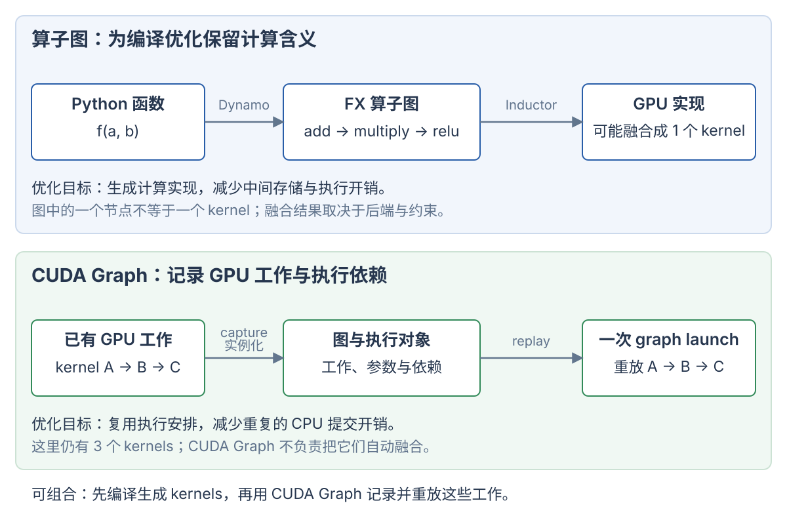

# 计算图、torch.compile 与 CUDA Graph

计算图用节点和边描述计算及依赖。编译器可以据此改变计算实现；执行系统也可以据此批量提交已有工作。**“把工作组织成图”不自动意味着融合成一个 kernel，也不自动意味着所有节点并行执行。**

`torch.compile` 是编译入口，TorchDynamo 捕获算子图，TorchInductor 优化并生成实现。CUDA Graph 记录 CUDA 工作与依赖，重点是复用执行安排、减少 CPU 提交开销。GPU 软件库的定位见 [GPU 软件栈](software-stack.md)。

## 1. 三种常见的图分别记录什么

| 图 | 节点主要表达什么 | 边主要表达什么 | 使用者 |
| --- | --- | --- | --- |
| 算子图，例如 FX graph | Tensor 算子、函数调用与参数 | 数据依赖 | 图转换与编译后端 |
| autograd 图 | 反向求导所需的操作与状态 | 梯度传播依赖 | PyTorch 自动求导系统 |
| CUDA Graph | CUDA kernel、复制及其他支持的工作 | 执行依赖 | CUDA 执行系统 |

算子图中的一个 matmul 节点，后端可能实现为一个或多个 kernels；几个逐元素节点也可能合并成一个 kernel。图节点的数量不能直接当作 kernel 数量。

autograd 图服务于梯度计算。`torch.compile` 也支持不求梯度的推理函数，因此编译图并不依赖程序必须先有一张反向求导图。训练路径中的 AOTAutograd 会准备前向、反向图，再交给后端编译。[PyTorch 编译组件](https://docs.pytorch.org/docs/2.9/torch.compiler.html)

## 2. 用同一个函数区分优化与重放

```python
import torch

def f(a, b):
    t = a + b
    u = t * 0.5
    return torch.relu(u)
```

假设 a/b 是同形状、连续的 CUDA 浮点 Tensor。普通 eager 路径通常逐个提交加法、乘法和 ReLU。输出依赖前一步，因此不能只因为画成图就把三个操作同时执行。



图中上半部分改变计算实现，下半部分复用提交安排。两者能够组合：先编译得到 kernel，再记录这些 kernel 的执行图。

### 算子图提供优化机会

算子图可以表达为：

```text
a ─┐
   add → multiply(0.5) → relu → output
b ─┘
```

编译器看到完整的数据依赖后，可能生成一个逐元素融合 kernel：

```text
读 a[i]、b[i]
    → 在局部临时值中计算 max((a[i] + b[i]) * 0.5, 0)
    → 写 output[i]
```

融合可以减少 kernel 启动，也可以消除 t/u 两个中间 Tensor 的物化。它改变了执行实现与数据移动。能否融合取决于算子支持、布局、依赖和后端策略。上面的一个 kernel 是说明用的可能结果，没有实机验证。

### CUDA Graph 提供执行重放

如果记录的是已有的三个 kernels，重放时仍然执行这三个 kernels：

```text
逐个提交：CPU → launch A；CPU → launch B；CPU → launch C

图重放：  CPU → graph launch → A → B → C
```

CUDA Graph 保存工作、参数和依赖，并在实例化后复用执行安排。它不负责把上述三个逐元素 kernel 改写成一个融合 kernel。重放减少了重复的 host 端参数准备和逐项提交开销；GPU 上仍有对应的执行与调度成本。[CUDA Graph 官方说明](https://docs.nvidia.com/cuda/cuda-programming-guide/04-special-topics/cuda-graphs.html)

## 3. torch.compile、Dynamo 与 Inductor 的关系

```text
torch.compile(f)                         用户入口
    ↓
TorchDynamo                             捕获 Tensor 计算，建立 guards
    ↓
FX graph                                算子及数据依赖
    ↓
AOTAutograd / 图转换                     按路径准备待编译计算
    ↓
TorchInductor（默认后端）                优化、组织计算并生成实现
    ↓
生成的 GPU kernels / 对已有计算库的调用
    ↓
符合条件时再使用 CUDA Graph             复用执行安排
```

### TorchDynamo 捕获可编译的程序区域

Dynamo 参与 Python 执行，提取 Tensor 操作及依赖，交给编译后端。Dynamo 本身不负责完成所有底层 kernel 优化，也不等于 CUDA Graph 的 stream capture。

为复用捕获和编译结果，Dynamo 建立 guards，即结果适用的条件。条件可以涉及 Tensor 的 dtype、device、shape 或程序状态；动态 shape 也可能使用符号条件。满足条件的后续调用可复用编译结果。Tensor 内的普通数值变化通常不要求重新编译。[Dynamo 概览](https://docs.pytorch.org/docs/2.9/torch.compiler_dynamo_overview.html)

例如，某个编译结果只支持 BF16 CUDA 输入，调用方换成 CPU FP32 输入时，原条件不再成立。系统可能编译另一份实现。guard 是判断实现是否适用的条件，不是每次检查所有 Tensor 元素。

### TorchInductor 生成和组织计算实现

Inductor 接收图，组织融合、调度和代码生成。它可以生成 Triton kernel，也可以调用已有的 matmul 库。后端仍可以保留多个 kernels，不要求把整个模型塞进一个 kernel。

```python
compiled_f = torch.compile(f, backend="inductor")
# 在 CUDA 输入上调用时，首次调用可能触发捕获与编译。
# 后续满足 guards 的调用可复用编译结果。
```

这里不承诺固定 kernel 数或固定耗时。`torch.compile` 可以选择其他后端；Dynamo 和 Inductor 是不同职责的组件。[torch.compile 接口](https://docs.pytorch.org/docs/2.9/generated/torch.compile.html)

### graph break 与重编译

graph break 表示捕获的计算在某处中断，程序可能分成多个编译区域，并由 Python 执行连接它们。依赖 Tensor 数值的 Python 控制流可能触发 graph break；例如把 `x.sum().item()` 取回 CPU，再决定 Python 分支。

guard 不满足则可能触发重编译。graph break 与重编译不是同一件事：前者关乎区域如何切分，后者关乎已有实现能否复用。

`torch.compile(f, fullgraph=True)` 要求函数捕获为单一图区域；遇到不支持的 graph break 会产生错误。**单一算子图仍可以编译成多个 GPU kernels。** [Dynamo 的 graph breaks、guards 与重编译](https://docs.pytorch.org/docs/2.9/torch.compiler.html#torch-compile-programming-model)

## 4. CUDA Graph 的创建与重放

CUDA Graph 可以通过显式 API 构建，也可以通过 stream capture 记录工作。capture 记录提交的工作，不表示已经完成本次 GPU 计算。典型阶段为：

1. 创建或捕获图，描述工作与依赖。
2. 实例化图，准备可重复提交的执行对象。
3. 重放图，用新的输入内容执行工作。

CUDA Graph 节点不只包含 kernels，CUDA API 还支持复制及其他节点。普通 PyTorch stream capture 不会把任意 Python 控制流或 CPU 副作用自动转成可重放工作。[CUDA Graph 创建与执行](https://docs.nvidia.com/cuda/cuda-programming-guide/04-special-topics/cuda-graphs.html)

### 数据可变，基础捕获模型中的地址保持稳定

在普通 PyTorch CUDA Graph 捕获与重放中，指针参数仍指向捕获时的地址。新 batch 可以复制到这些输入缓冲区，再重放图。换一个 Tensor 对象并重新绑定 Python 变量，不会自动改变图里的指针。

```text
static_a 原来指向地址 P
    ↓ capture
图中的输入指针为 P

static_a.copy_(new_a)     更新 P 中的数据，重放能读到新内容
static_a = new_a         只改 Python 绑定，图仍然读取 P
```

因此需要让输入/输出缓冲区持续存活。底层 CUDA 有图更新机制，上层编译系统也能管理多份捕获。地址稳定的描述针对这里的基础重放模型。[PyTorch CUDA Graph 内存语义](https://docs.pytorch.org/docs/2.9/notes/cuda.html#cuda-graphs)

### PyTorch 手动捕获示意

下面代码与上文 f 配合使用。它是 CUDA 示例，未运行；warmup 在 side stream 上执行，保留静态输入和输出引用。

```python
static_a = torch.randn(1024, device="cuda")
static_b = torch.randn(1024, device="cuda")

warmup_stream = torch.cuda.Stream()
warmup_stream.wait_stream(torch.cuda.current_stream())
with torch.cuda.stream(warmup_stream):
    for _ in range(3):
        f(static_a, static_b)
torch.cuda.current_stream().wait_stream(warmup_stream)

graph = torch.cuda.CUDAGraph()
with torch.cuda.graph(graph):
    static_output = f(static_a, static_b)

new_a = torch.randn_like(static_a)
new_b = torch.randn_like(static_b)
static_a.copy_(new_a)
static_b.copy_(new_b)
graph.replay()
# static_output 是这次重放的输出；后续重放会复用其存储。
```

重放的目标是复用已经准备的工作。捕获、实例化、warmup、输入复制与执行本身仍有成本。Python 中的打印或日志不会因为放进捕获上下文，就在每次 replay 时重新执行。

## 5. 编译优化与 CUDA Graph 能组合，但互不等同

| 使用方式 | 在这个逐元素示例中可能发生什么 | 主要改变 |
| --- | --- | --- |
| eager | 分别提交加法、乘法、ReLU | 按算子直接执行 |
| 只用图编译优化 | 三个操作可能融合成一个 kernel | 计算实现、kernel 数与中间存储 |
| 只记录原始工作为 CUDA Graph | 一个 graph launch 提交原来的三个 kernels | CPU 提交方式 |
| 编译后再使用 CUDA Graph | 重放编译产生的工作 | 同时复用优化实现与执行安排 |

```python
compiled_f = torch.compile(f, mode="reduce-overhead")
```

这个模式会尝试利用 CUDA Graph 降低开销，但受设备、计算内容和捕获约束影响。不能仅凭使用了这个模式，就宣称每次执行都成功重放 CUDA Graph。编译器也可能跳过不安全的区域。[CUDA Graph Trees](https://docs.pytorch.org/docs/2.9/torch.compiler_cudagraph_trees.html)

一份可处理动态 shape 的编译图，可以对应多份具体 shape 的 CUDA Graph 捕获。推理系统也可能把 batch 大小归入有限的 buckets，分别维护捕获与静态缓冲区。因此“编译图支持动态 shape”与“单份基础 CUDA Graph 的参数固定”能够同时成立。

## 6. 计算图怎样影响性能

计算图为后端提供计算关系。后端可以利用这些关系融合算子、消除中间存储、调整调度或规划内存。能实现哪些优化取决于后端和计算。CUDA Graph 则复用工作与依赖的执行安排，减少重复提交。

如果一个大 GEMM 已经持续使用 GPU，减少 host 提交开销不一定显著改变总耗时。如果程序由多个短 kernels 构成，且 CPU 提交造成间隙，CUDA Graph 更可能带来收益。这里是在说明机制，不能替代实际时间线和受控测量。

profiler 可以记录 kernel 数量、CPU 提交与 GPU 工作之间的空隙、graph replay 及总延迟。对照编译前后的记录，才能确认实际收益。本页没有执行编译、图捕获、CUDA 用例或性能测试。
