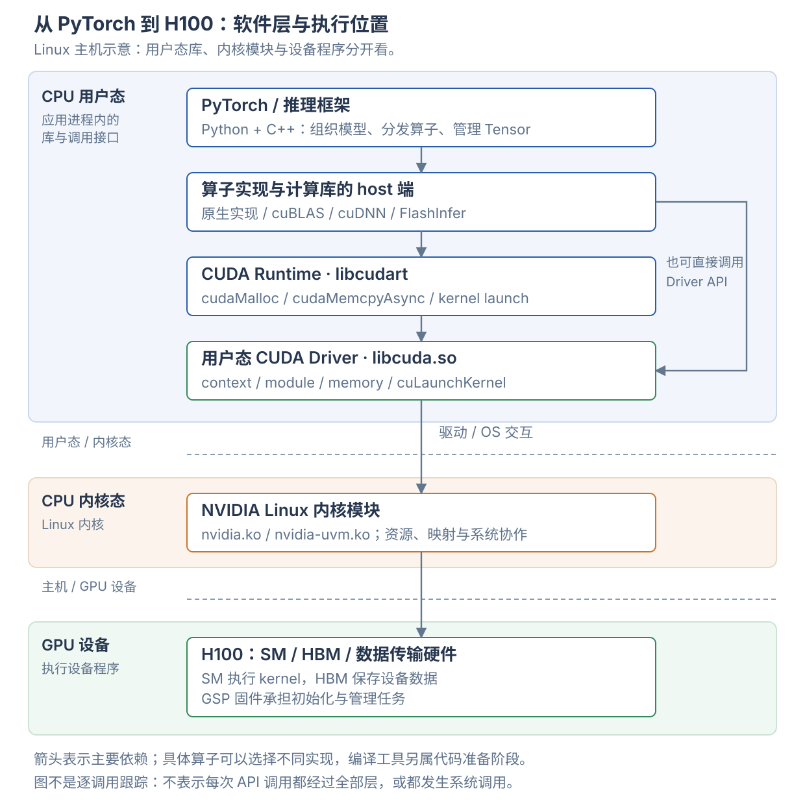

# 从 H100 到 PyTorch：驱动、运行时与框架

H100 是执行计算的设备。CPU 上的应用、计算库和驱动组织工作，把 GPU 程序和数据交给设备；GPU 再执行指令。**CUDA Runtime、用户态 CUDA Driver 和 Linux 内核驱动是三个不同的软件部分。**

本页以 Linux / x86 主机使用 H100 为例。Windows、虚拟机直通和 Grace Hopper 的部分边界不同。各计算库的用途见 [GPU 软件栈与工具](software-stack.md)，设备代码怎样生成见 [PTX、SASS 与编译流程](../cuda/compilation-and-instructions.md)。

## 1. 先把执行位置分开

| 位置 | 放着什么 | 执行什么 |
| --- | --- | --- |
| CPU 用户态 | Python 进程、PyTorch 的 C++ 部分、计算库的 host 接口、libcudart、libcuda | 组织模型、选择实现、管理执行对象、提交 GPU 工作 |
| CPU 内核态 | Linux 内核及 NVIDIA 内核模块 | 管理设备与受保护的系统资源，协作维护进程隔离和内存映射 |
| GPU 设备 | H100 的 SM、HBM、复制引擎和管理处理器 | 执行 GPU kernel、访问显存、传输数据和管理设备 |

用户态与内核态是 CPU 侧的权限边界。host 与 device 是主机与 GPU 的执行位置边界。不能因为一个库叫 Driver，就认定它在 Linux 内核中运行。



图表示主要依赖关系。框架按算子选择实现，也可以直接调用 Driver API。箭头不代表每次 API 调用都经过所有矩形，更不代表每次提交都发生一次系统调用。图中计算库矩形表示 CPU 调用侧，库还可以携带供 GPU 执行的代码。

NVIDIA 将 CUDA 环境区分为用户态 Toolkit、用户态 CUDA Driver，以及内核态设备驱动。[官方软件部署说明](https://docs.nvidia.com/datacenter/tesla/drivers/software-deployment-workflow.html)

## 2. 硬件与固件：GPU 接收什么工作

CPU 执行应用的控制逻辑；H100 执行 GPU 程序。GPU kernel 的机器码描述线程做什么，启动参数描述 grid/block 和函数参数。复制工作则让设备移动数据，例如在主机内存与 HBM 之间传输。

HBM 保存权重、激活、KV cache 与 workspace。SM 上的寄存器和 shared memory 用于执行中的线程状态及协作。GPU 还具有地址翻译、调度、同步和数据传输硬件；不能把所有工作都理解为 CUDA Core 的算术。

**固件是驱动与硬件之间的另一类软件。** 例如 GPU System Processor（GSP）运行配套固件，承担 GPU 初始化与管理任务。固件随驱动发布，并不等于开发者编写的 attention 或 GEMM kernel。[NVIDIA GSP 固件说明](https://download.nvidia.com/XFree86/Linux-x86_64/580.95.05/README/gsp.html)

## 3. Linux 内核态驱动：让操作系统能管理设备

NVIDIA 驱动安装后，Linux 中可以加载多个内核模块。模块职责不同，计算服务器与图形桌面的配置也可以不同。

| 模块 | 主要职责 |
| --- | --- |
| `nvidia.ko` | 核心设备驱动，与用户态驱动及固件协作管理 GPU 资源 |
| `nvidia-uvm.ko` | Unified Virtual Memory 管理及相关内存功能 |
| `nvidia-modeset.ko` | 显示模式管理 |
| `nvidia-drm.ko` | 与 Linux DRM 图形子系统集成 |
| `nvidia-peermem.ko` | 为支持的 RDMA 场景提供 GPU 内存对接 |

GPU 设备、进程资源、权限、内存映射、中断和错误处理，需要驱动与操作系统协作。应用通过用户态库使用这些能力；普通 Python 代码不会直接操作内核内部的设备对象。

Linux 上还常见 `/dev/nvidia0`、`/dev/nvidiactl`、`/dev/nvidia-uvm` 这样的设备节点。设备节点是驱动向用户态暴露接口的入口，不是把 HBM 当作普通文件使用。

**Linux kernel module 与 CUDA kernel 是两种东西。** 前者运行在 CPU 的操作系统内核中；后者运行在 GPU 上。名称都含 kernel，但它们不是同一种程序。

模块清单见 [NVIDIA 驱动安装指南](https://docs.nvidia.com/datacenter/tesla/driver-installation-guide/kernel-modules.html)，开放模块的源代码见 [open-gpu-kernel-modules](https://github.com/NVIDIA/open-gpu-kernel-modules)。开放内核模块不意味着用户态 CUDA 库和 GPU 固件都采用相同的开源方式。

## 4. 用户态 CUDA Driver：libcuda.so

`libcuda.so.1` 是 Linux 上 CUDA 用户态驱动的共享库入口。它加载到 CPU 进程的用户态地址空间，提供 CUDA Driver API，并与驱动的其他部分协作。

常规 Linux 安装中，`libcuda` 与内核模块随驱动配套发布。`libcudart` 则属于 CUDA Runtime，可以来自系统 Toolkit 或应用的运行依赖。把这两个库放到同一进程中，不会改变它们各自的职责。[驱动与 Toolkit 的分发关系](https://docs.nvidia.com/datacenter/tesla/drivers/software-deployment-workflow.html)

| Driver API 示例 | 管理的对象或动作 |
| --- | --- |
| `cuInit`、`cuDeviceGet` | 初始化 Driver API、获取设备 |
| `cuCtxCreate`、primary context 接口 | 创建或使用 CUDA 执行上下文 |
| `cuMemAlloc`、VMM 接口 | 分配设备内存、管理地址与映射 |
| `cuModuleLoad`、`cuModuleGetFunction` | 加载设备代码模块、取得 kernel 入口 |
| `cuLaunchKernel` | 提交 kernel 的启动配置和参数 |
| stream / event / graph 接口 | 管理工作顺序、依赖和重复提交 |

例如，应用已经有一份 cubin 和若干 GPU 指针，可以通过 Driver API 加载程序、找到函数，再启动函数。上层框架、JIT 系统或自定义扩展可以直接走这条路径。

`libcuda` 是 CPU 侧控制库，GPU kernel 才是送往设备执行的程序。前者负责调用与管理，后者负责设备上的计算。

## 5. CUDA Runtime：libcudart

CUDA Runtime 提供另一套常用接口，动态链接时通常由 `libcudart.so` 提供，也有静态链接方式。

| Runtime API 示例 | 常见用途 |
| --- | --- |
| `cudaSetDevice` | 选择当前调用使用的设备 |
| `cudaMalloc`、`cudaFree` | 设备内存分配与释放 |
| `cudaMemcpyAsync` | 提交异步复制 |
| `cudaStreamCreate`、`cudaEventRecord` | 创建工作流、记录依赖或完成标记 |
| `cudaLaunchKernel`、CUDA C++ 启动语法 | 启动设备函数 |
| `cudaGraphLaunch` | 提交可执行 CUDA Graph |

Runtime 帮调用者管理上下文与设备模块的常见用法，减少显式管理工作。Driver API 提供对上下文和模块加载的更细控制。两套 API 能协作使用；Runtime 通常使用当前进程在该设备上的 primary context，或使用显式设置的上下文。[Driver API 与 Runtime API 的区别](https://docs.nvidia.com/cuda/cuda-runtime-api/driver-vs-runtime-api.html)

常见关系为：

```text
应用 / 计算库
    ├── Runtime API：cudaMalloc、cudaMemcpyAsync、cudaLaunchKernel
    │       ↓
    │   用户态 Driver
    │
    └── 直接调用 Driver API：cuMemAlloc、cuModuleLoad、cuLaunchKernel
            ↓
        用户态 Driver
```

**直接调用 Driver API，不需要先绕一遍 Runtime API。** `cu` 和 `cuda` 是这里两组 API 的命名线索，但名字以 cu 开头的 cuBLAS、cuDNN 并不因此成为 Driver API。

这里的 runtime 指 CUDA 的执行支持库。它与模型推理 runtime、Docker 的 container runtime 各有含义，不能仅凭 runtime 这个词判断层次。

## 6. Context、module、stream、event、graph 分别是什么

| 对象 | 表达什么 | 放到一次计算里理解 |
| --- | --- | --- |
| CUDA context | 使用设备资源的执行环境 | 关联设备、地址空间及设备资源状态 |
| module | 加载的设备代码模块 | 包含可供调用的 kernel 入口 |
| kernel / function | GPU 上执行的函数 | 例如一次矩阵计算的设备函数 |
| stream | 有序提交工作的抽象 | 复制、填充、计算可以按依赖顺序进入同一 stream |
| event | 记录进度及建立依赖的对象 | 让另一个 stream 等待某项工作完成 |
| graph / graph executable | 工作及依赖、实例化后的执行对象 | 重复提交已经准备好的工作安排 |

一个进程可以使用多个 GPU，也可以显式管理上下文。Runtime 常见的 primary context 是每进程、每设备的资源，不要把“一个进程只有一个 CUDA context”当作通用规则。

stream 不是 CPU 线程，也不是为某个 SM 永久分配的通道。不同 streams 的工作是否重叠，取决于依赖、资源和硬件支持。进入同一 stream 的工作按其顺序语义执行，不要求 CPU 在提交每一步后等待。[CUDA 异步执行](https://docs.nvidia.com/cuda/cuda-programming-guide/02-basics/asynchronous-execution.html)

## 7. 计算库：CPU 接口与 GPU 实现一起工作

调用 `cublasGemmEx` 时，CPU 执行库的 host 端代码。库检查参数、选择算法并提交工作；设备 kernel 在 GPU 上做矩阵计算。一个算子调用可以产生多个 kernel，也可以使用已有的 workspace。

| 组件 | Linux 动态构建中的常见库名 | 提供的能力 |
| --- | --- | --- |
| cuBLAS / cuBLASLt | `libcublas.so` / `libcublasLt.so` | 线性代数与矩阵乘法 |
| cuDNN | `libcudnn*.so` | 深度学习算子与支持的融合计算 |
| NCCL | `libnccl.so` | GPU 间通信，例如 all-reduce |
| FlashInfer | Python 包、扩展及按实现准备的设备代码 | 面向推理的 attention、采样和其他 kernels |
| 框架原生或自定义 kernel | 随框架库或自定义扩展打包 | 库之外需要的计算实现 |

表中库名省略版本后缀。实际库文件的拆分与位置取决于发行包和构建方式。

库的共享对象可以同时包含 CPU 代码与打包的设备代码。不能从 `.so` 文件名推断所有计算都在 CPU 上完成。使用 Tensor Core 的指令来自所选 kernel；CPU 驱动不会在每个矩阵元素上替 GPU 做乘加。

具体库及 kernel 开发工具的关系见 [GPU 软件栈与工具](software-stack.md)。

## 8. PyTorch 与上层推理框架

PyTorch 为用户提供 Python Tensor 和模型接口，同时有 C++ 实现与不同设备后端。

| 名称 | 所处位置与职责 |
| --- | --- |
| Python `torch` / `torch.nn` | 用户表达 Tensor 计算和模型结构的接口 |
| `torch._C` | Python 与编译后的 PyTorch 实现之间的绑定入口之一 |
| ATen | PyTorch 的 Tensor 与算子实现层，具有 CPU/CUDA 后端 |
| dispatcher / c10 分发机制 | 根据注册的实现和分发条件选择算子路径 |
| CUDA caching allocator | 复用设备内存块，服务 Tensor 存储分配 |
| cuBLAS / 原生 CUDA 实现 | 执行被选中的具体计算 |

例如，普通 CUDA 矩阵乘法可以经过 ATen 的 CUDA 实现，再调用 cuBLAS 或 cuBLASLt。CUDA 上的加法也可能直接使用框架原生 kernel；并非每个算子都要经过 cuBLAS。

分发机制见 [PyTorch dispatcher](https://docs.pytorch.org/tutorials/advanced/dispatcher.html)。可对照 PyTorch v2.9.0 的 [CUDA 矩阵算子实现](https://github.com/pytorch/pytorch/blob/v2.9.0/aten/src/ATen/native/cuda/Blas.cpp) 与 [cuBLAS 调用封装](https://github.com/pytorch/pytorch/blob/v2.9.0/aten/src/ATen/cuda/CUDABlas.cpp)；具体路径受版本、输入和配置影响。

`torch.compile` 位于程序捕获与编译的一侧，可以生成 kernel 或选择已有实现。它不会替代 CUDA Driver。编译结果仍需要加载和提交，才能在 GPU 上执行。详见 [计算图、编译与 CUDA Graph](graphs-and-compilation.md)。

SGLang、vLLM 位于请求与模型执行的一侧，组织请求、batch、KV cache 和多卡工作。TensorRT、TensorRT-LLM 提供模型推理优化与运行时能力。它们可以选择不同的计算实现，但底层设备访问仍需要驱动支持。

各层接收和解释的对象也不同：

| 层次 | 主要理解的对象 |
| --- | --- |
| 推理服务框架 | 请求、tokens、batch、KV cache 状态 |
| PyTorch | Tensor、模型、参数与算子 |
| cuBLAS 等计算库 | 矩阵尺寸、布局、类型与数据指针 |
| CUDA 执行接口与驱动 | context、设备代码、地址、启动参数与依赖 |
| GPU 执行硬件 | 机器指令、线程工作与存储访问 |

因此 Driver 不需要理解某个请求的聊天内容，计算库也不负责决定下一轮服务哪个用户。每层把需要的信息转换成下一层能使用的对象。

## 9. 跟着一次矩阵乘法走完流程

下面是用于解释调用关系的 CUDA 示例，未运行：

```python
import torch

x_cpu = torch.ones((4, 4), dtype=torch.float16)
x = x_cpu.to("cuda")
w = torch.ones((4, 4), device="cuda", dtype=torch.float16)
y = x @ w
y_cpu = y.cpu()
# 数学预期：y_cpu 的每个元素都是 4。
```

### 初始化与内存

导入 PyTorch 会加载 Python 包与其编译依赖，但不必立即完成全部 CUDA 初始化。使用 CUDA 功能时，框架按需初始化设备支持。[torch.cuda 说明](https://docs.pytorch.org/docs/2.9/cuda.html)

`x_cpu.to("cuda")` 需要 GPU 存储和数据复制。PyTorch 分配器可以复用已有显存块；需要新块时才向下层分配器请求。CUDA 与驱动管理设备分配和地址映射，复制工作把输入内容送到设备可访问的目标位置。[PyTorch 内存管理](https://docs.pytorch.org/docs/2.9/notes/cuda.html#memory-management)

`torch.ones(..., device="cuda")` 既要取得存储，也要生成指定内容。GPU Tensor 的创建不一定只涉及一次内存分配。

### 选择实现与提交

`x @ w` 进入矩阵算子的 CUDA 路径，选择具体实现，并准备输入/输出指针和执行参数。计算库或框架借助 Runtime API 或 Driver API 提交工作。

加载的设备代码包含 kernel 的机器指令。H100 执行这些指令，按程序访问 Tensor 数据。是否采用 Tensor Core，取决于具体实现与计算模式，不能仅凭 Python 中出现 `@` 判断。

### 执行与取回结果

CUDA 提交通常对 CPU 异步，因此得到 Tensor 对象 y，不表示 GPU 已经写完其内容。同一 stream 的顺序语义能连接填充、复制与计算；CPU 不必在每一步之间主动同步。

`y.cpu()` 要把结果放进 CPU 存储，必须正确等待所需的 GPU 工作与复制完成。这与“CPU 拿到一个 GPU Tensor 的 Python 对象”是不同的动作。异步语义见 [PyTorch CUDA semantics](https://docs.pytorch.org/docs/2.9/notes/cuda.html#asynchronous-execution)。

```text
Python 表达 x @ w
    → PyTorch 分发与 CUDA 实现
    → 计算库或框架 kernel 的 host 端准备
    → CUDA Runtime / Driver API
    → 设备代码与工作提交
    → H100 执行
    → 按需要等待并复制结果
```

## 10. 编译工具与运行库分处不同阶段

| 阶段 | 常见组件 | 产生什么或做什么 |
| --- | --- | --- |
| 生成实现 | nvcc、Triton compiler、CuTe DSL 编译管线 | 将 kernel 源程序转换为设备代码 |
| 打包与链接 | 编译、链接及打包工具 | 让应用或库携带设备代码和 host 端接口 |
| 加载 | Runtime / Driver 的模块管理 | 为本次执行准备设备函数 |
| 执行 | stream、graph、设备函数启动接口 | 提交工作并管理依赖 |

编译可以提前完成，也可以在首次使用时完成。已有 cubin 可以加载执行；兼容的 PTX 也可以在运行时针对目标 GPU 编译。编译不是每次算子调用都必经的一次完整流程。详细路径见 [PTX、SASS 与编译流程](../cuda/compilation-and-instructions.md)。

不同文件也有不同含义：

| 文件或表示 | 主要含义 |
| --- | --- |
| `.so` | Linux 用户态共享库，可携带 host 代码与设备程序 |
| `.ko` | Linux 内核模块，执行于 CPU 内核态 |
| `.ptx` | GPU 虚拟指令表示，需要转换为目标机器代码 |
| `.cubin` | 包含 GPU 机器代码的 CUDA 二进制模块 |
| SASS | GPU 原生机器指令的汇编表示，不是 Linux 驱动模块 |

## 11. 安装、容器与版本号怎样对应

### Toolkit、Driver 与应用依赖

CUDA Toolkit 是开发工具包，包含开发库、头文件和编译工具。NVIDIA Driver 安装提供与设备配合的驱动组件。应用运行时需要相应库，但不一定需要系统安装完整 Toolkit。预编译应用可以携带或依赖运行所需的库。

例如，CUDA 版 PyTorch wheel 可以通过配套依赖提供运行库和计算库。它仍需要主机驱动。编译自定义 CUDA C++ 扩展则可能需要 Toolkit 中的 nvcc 和头文件；Triton 与 CuTe DSL 有各自的编译依赖。[NVIDIA 部署说明](https://docs.nvidia.com/datacenter/tesla/drivers/software-deployment-workflow.html)

### 容器共享主机内核驱动

Linux GPU 容器中的应用通常使用镜像内的框架与 CUDA 运行依赖。NVIDIA Container Toolkit 配合容器引擎暴露所选 GPU 设备及所需驱动库，使应用能够访问主机 GPU。

```text
容器内用户态：Python、PyTorch、libcudart、计算库
    ↓ 配合暴露的设备与驱动接口
主机 NVIDIA 驱动 / Linux 内核
    ↓
H100
```

容器没有为每个镜像启动一份独立的 Linux GPU 内核驱动。具体暴露的库、设备与能力由运行配置决定；兼容包等特殊配置还需要单独核对。[Container Toolkit 架构](https://docs.nvidia.com/datacenter/cloud-native/container-toolkit/latest/arch-overview.html)、[容器 GPU 能力配置](https://docs.nvidia.com/datacenter/cloud-native/container-toolkit/latest/docker-specialized.html)

### 常见版本号不是同一个对象

`nvidia-smi` 的字段名会随版本变化。下面同时列出常见旧名称与新版名称。

| 看到的位置 | 主要说明什么 |
| --- | --- |
| `nvidia-smi` 的 Driver Version / KMD Version | 驱动版本字段；KMD 明确表示内核态驱动版本 |
| `nvidia-smi` 的 CUDA Version / CUDA UMD Version | CUDA 用户态驱动报告支持的最高 CUDA 版本，不等于已安装的 Toolkit |
| `nvcc --version` | 这个 nvcc 所属编译工具包的版本 |
| `torch.version.cuda` | 该 PyTorch 构建使用的 CUDA 版本信息 |
| cuDNN / NCCL / FlashInfer 版本 | 各自组件的版本 |

多个版本号不同并不自动表示错误。较新驱动通常能够运行使用较早 CUDA 版本构建的应用，但还存在最低驱动、PTX 与特性要求。具体兼容范围应按对应版本矩阵检查。[CUDA 兼容性](https://docs.nvidia.com/cuda/cuda-compatibility/index.html)、[nvidia-smi 文档](https://docs.nvidia.com/deploy/nvidia-smi/index.html)

## 12. 监控工具与调度职责

`nvidia-smi` 通过 NVIDIA Management Library（NVML）查询设备与进程状态。Linux 上常见的 NVML 库名是 `libnvidia-ml.so.1`。这是管理和监控接口；`libcuda.so.1` 提供 CUDA Driver API，`libcudart` 提供 Runtime API，它们不是同一个库。[NVML 文档](https://docs.nvidia.com/deploy/nvml-api/nvml-api-reference.html)

`nvidia-smi` 成功，只能证明相应管理访问能够工作。它不能单独证明某个 Python 环境已经安装 CUDA 版框架，也不能证明某段 kernel 已编译并运行。

“调度”也有不同粒度：

| 调度层次 | 主要决定什么 |
| --- | --- |
| 推理框架 | 本轮服务哪些请求、组成什么 batch |
| CUDA 提交与依赖 | kernels、复制、通信怎样排序与协作 |
| 驱动与设备执行环境 | 设备资源与上下文的管理、共享及运行支持 |
| GPU block / warp 调度 | 已提交工作怎样驻留并使用执行资源 |

CPU 侧的框架不会为每次标量运算决定使用哪一个 CUDA Core。H100 负责执行提交的设备程序，具体线程组织见 [CUDA 执行层级与硬件映射](../cuda/execution-hierarchy.md)。

本页核对了官方接口文档和所标版本的源码。图示表达职责与边界，未抓取某台 H100 的实际调用跟踪；CUDA 示例未运行。
