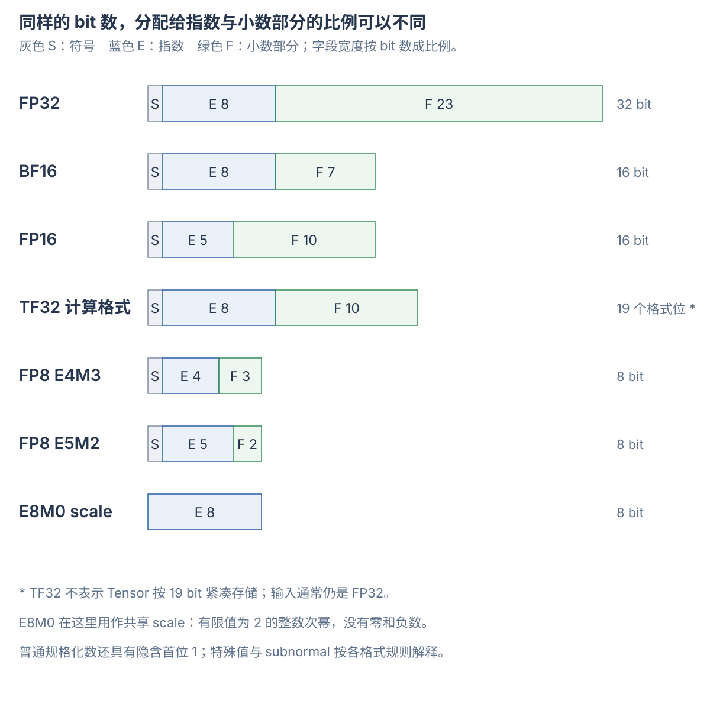

# 浮点格式、混合精度与量化

FP32、FP16、BF16 描述数值格式；TF32 描述常见的矩阵乘法计算精度；E4M3、E5M2 明确指数与小数部分的位数。**E8M0 在 MX 格式中通常保存共享缩放因子，不是带正负号和零的普通 FP8 数据格式。**

一次矩阵计算还要分别说明输入存储、乘法精度、累加类型、输出存储和量化比例。Tensor Core 与软件选择实现的关系见 [GPU 软件栈与工具](software-stack.md)，程序怎样变成设备指令见 [PTX、SASS 与编译流程](../cuda/compilation-and-instructions.md)。

## 1. float、FP16、BF16 这些名字指什么

| 名称 | 常见含义 | 在 PyTorch / CUDA 中怎样看 |
| --- | --- | --- |
| float / FP32 / single | 32 位浮点 | `torch.float32`、别名 `torch.float`；CUDA C++ 的 `float` |
| double / FP64 | 64 位浮点 | `torch.float64`、`torch.double`；CUDA C++ 的 `double` |
| half / FP16 | 16 位浮点 | `torch.float16`、`torch.half`；5 位指数、10 位小数部分 |
| BF16 / bfloat16 | 另一种 16 位浮点 | `torch.bfloat16`；8 位指数、7 位小数部分 |
| TF32 / TensorFloat-32 | NVIDIA 矩阵计算模式 | 通常使用 FP32 Tensor 存储，乘法保留较少有效位 |
| FP8 | 8 位浮点格式家族 | 必须继续说明 E4M3、E5M2 或具体变体 |
| FP6 / FP4 | 6 位 / 4 位浮点格式家族 | 通常配合块级 scale 和专用 kernel 使用 |

Python 内置的 `float` 在常见 CPython 平台使用 64 位双精度。`torch.float` 则是 `torch.float32` 的别名。PyTorch 初始默认浮点 dtype 通常是 FP32，但允许修改；不要只看“float”这个词就断定所有环境都是同一种类型。[Python 浮点说明](https://docs.python.org/3/tutorial/floatingpoint.html)、[PyTorch dtype](https://docs.pytorch.org/docs/2.9/tensor_attributes.html)

BF16 与 FP16 都占 16 bit，但不是同一种编码。只有总位数相同，不能说明范围、误差或二进制表示相同。

## 2. 符号、指数与小数部分怎样组成一个数

常见二进制浮点包含三个字段：

```text
S：符号位
E：指数编码
F：小数部分编码，存储 M 个 bit
```

对普通规格化数，可以写成：

$$
x=(-1)^S\times 2^{E-\mathrm{bias}}\times\left(1+\frac{F}{2^M}\right)
$$

例如十进制 5.625：

```text
5.625 = 二进制 101.101
      = 二进制 1.01101 × 2²
```

在 FP16 中，S=0，指数编码为 `2+15=17`，小数部分编码为 `0110100000`。规格化数的开头 `1` 不需要显式存储，因此 10 个小数部分 bit 提供 11 个有效二进制位。



指数决定量级，小数部分决定同一量级中能细分多少个位置。这里把 F 字段称为“小数部分”。资料中的 mantissa bits 往往也指这个存储字段，完整有效数还包括规格化数的隐含首位。

零和特殊值有各自的编码规则，subnormal、Inf 和 NaN 都需要分别解释。不能把所有 bit 模式都直接代入规格化公式。特殊值规则也可能随格式变化。[NVIDIA 浮点与 IEEE 754](https://docs.nvidia.com/cuda/floating-point/index.html)

## 3. 范围与精细程度是两件事

下表的步长指 **1 到下一个更大可表示数的距离**。最小正规格化数与最小正数不同，后者还可能是 subnormal。

| 格式 | S / E / F 位数 | 最大有限正值 | 最小正规格化正值 | 1 附近向上的步长 |
| --- | --- | --- | --- | --- |
| FP64 | 1 / 11 / 52 | 约 1.798×10³⁰⁸ | 2⁻¹⁰²² | 2⁻⁵² |
| FP32 | 1 / 8 / 23 | 约 3.403×10³⁸ | 2⁻¹²⁶ | 2⁻²³ |
| BF16 | 1 / 8 / 7 | 约 3.390×10³⁸ | 2⁻¹²⁶ | 2⁻⁷ = 0.0078125 |
| FP16 | 1 / 5 / 10 | 65504 | 2⁻¹⁴ | 2⁻¹⁰ = 0.0009765625 |
| FP8 E4M3 | 1 / 4 / 3 | 448 | 2⁻⁶ | 2⁻³ = 0.125 |
| FP8 E5M2 | 1 / 5 / 2 | 57344 | 2⁻¹⁴ | 2⁻² = 0.25 |

BF16 的指数范围接近 FP32，小数部分却短于 FP16。因此，BF16 更能容纳不同量级的数；在共同覆盖的量级中，FP16 的网格通常更细。[CUDA BF16 定义](https://docs.nvidia.com/cuda/cuda-math-api/cuda_math_api/struct____nv__bfloat16.html)

以常见的最近舍入方式看：

```text
1.001：
    FP16 → 1.0009765625
    BF16 → 1.0

100000：
    超过 FP16 的最大有限值
    BF16 仍能表示这一量级，但会舍入，例如约为 99840
```

“7 位小数部分”不是保留 7 位十进制小数。浮点间距还会随量级变化。例如 FP16 在 `[1,2)` 的间距是 2⁻¹⁰，在 `[2048,4096)` 的间距变成 2。

### 舍入、溢出与 subnormal

| 术语 | 含义 |
| --- | --- |
| rounding / 舍入 | 精确结果落在网格之间，需要选择一个可表示值 |
| round-to-nearest, ties-to-even | 选最近值；正好在中间时，取保留有效数最低位为 0 的结果 |
| overflow / 溢出 | 结果超出可表示范围，按转换规则得到 Inf、NaN 或饱和值 |
| underflow / 下溢 | 结果靠近零，可能进入 subnormal、舍入为零或被指令清零 |
| subnormal / 非规格化数 | 不使用隐含首位 1，表达正规格化范围与零之间的部分小值 |

例如 FP16 最小正规格化正值是 2⁻¹⁴，但最小正 subnormal 是 2⁻²⁴。编码能表达某个值，不保证每种硬件指令都以相同方式处理它；还要看计算与转换模式。

## 4. FP8 的 E4M3、E5M2 指什么

对这里的 FP8 数据格式，ExMy 中的 x/y 分别表示指数与小数部分 bit 数，另有 1 个符号 bit：

```text
E4M3：1 + 4 + 3 = 8 bit
E5M2：1 + 5 + 2 = 8 bit
```

E4M3 提供更细的有效数网格，E5M2 提供更大的指数范围。两者每元素都占 1 byte，但适用的数值分布可能不同。

本文表中的 E4M3 按 OCP 编码理解：最大有限值 448，没有 Inf，但保留 NaN。E5M2 的最大有限值是 57344，并支持 Inf。相同总位数不意味着特殊值规则一致。[OCP MX 规范中的 FP8 编码表](https://www.opencompute.org/documents/ocp-microscaling-formats-mx-v1-0-spec-final-pdf)

PyTorch 中还会看到 `float8_e4m3fn`、`float8_e4m3fnuz`。这类后缀区分特殊值和编码规则。不能只按 E/M 位数就假设所有变体二进制兼容。本文的 448 范围对应这里说明的 OCP E4M3，而不是任意 E4M3 变体。

## 5. TF32：存储为 FP32，乘法可以使用另一种精度

TF32 的计算格式包含 1 个符号位、8 个指数位和 10 个小数部分位。其指数范围接近 FP32，乘法有效数精度接近 FP16。它通常仍从 FP32 Tensor 读取，结果可用 FP32 累加并写回 FP32。

```text
FP32 输入存储
    → 乘法按 TF32 精度使用操作数
    → FP32 累加
    → FP32 输出存储
```

因此 `y.dtype == torch.float32` 不能证明乘法保留了完整 FP32 有效位。启用 TF32 也不把原来的 FP32 Tensor 变成每元素 19 bit 的紧凑存储。

在支持相应新接口的 PyTorch 版本中，可以设置：

```python
import torch

torch.backends.cuda.matmul.fp32_precision = "ieee"  # 要求 FP32 内部精度
# 或设置为 "tf32"，允许 TF32 内部精度；不要与旧控制接口混用。
```

这里控制的是允许的计算精度，具体实现仍由后端选择。其他接口中的 `high` 也不等于唯一指定 TF32，可能允许其他低精度分解算法。[PyTorch TF32 与精度控制](https://docs.pytorch.org/docs/2.9/notes/cuda.html#tensorfloat-32-tf32-on-ampere-and-later-devices)

## 6. 输入、乘法、累加和输出分别决定什么

矩阵乘法的一个输出是：

$$
c_{ij}=\sum_k a_{ik}b_{kj}
$$

| 模式示例 | 输入存储 | 乘法操作数精度 | 累加类型 | 输出可以怎样保存 |
| --- | --- | --- | --- | --- |
| FP16 混合计算 | FP16 | FP16 | FP32 | 按接口写回 FP16 或 FP32 |
| BF16 混合计算 | BF16 | BF16 | FP32 | 按接口写回 BF16 或 FP32 |
| TF32 路径 | FP32 | TF32 | FP32 | FP32 |
| INT8 矩阵计算 | INT8 | INT8 | INT32 | 整数结果或经缩放转换的结果 |
| 块缩放 FP8 | FP8 元素与 scales | 对应 FP8 矩阵操作，结合 scales | 常见为 FP32 | 按接口与 epilogue 转换 |

“FP16 输入、FP32 累加”不表示每个乘积必须先舍入成 FP16，再转换为 FP32。矩阵指令规定乘法与累加行为，不能仅凭输入 Tensor 的 dtype 推断中间步骤。[cuBLAS 计算类型](https://docs.nvidia.com/cuda/cublas/index.html)

### 较宽的累加器为什么有用

按最近舍入、遇中点取偶数计算：

```text
FP16 中，2048 的下一个更大值是 2050。
2048 + 1 的精确结果是 2049，舍入后回到 2048。

如果每次都把部分和舍入为 FP16：
    从 2048 开始，加 1 共 1024 次，部分和可以一直停在 2048。

如果使用 FP32 累加：
    这组整数加法可以精确累加到 3072。
```

较宽的累加器减少求和中的误差，但不能恢复输入转换时已经丢失的信息。把 1.001 转成 BF16 得到 1.0 后，再用 FP32 累加，也不能自动恢复原来的 0.001。

### FMA、MMA 与计算顺序

FMA 是 Fused Multiply-Add，表达一次融合乘加。标准 FMA 对精确的 `a*b+c` 作最终舍入，避免先把乘积单独舍入、再与 c 相加。MMA 是矩阵乘加。整条矩阵指令的累加顺序和数值规则还需要看指令定义，不能只凭名称推断逐步行为。

浮点加法也不保证结合律。假设每一步都按 FP32 最近舍入：

```text
(100000000 + (-100000000)) + 1 → 1
100000000 + ((-100000000) + 1) → 0
```

第二行中，`-100000000 + 1` 在 FP32 网格上舍入回 `-100000000`。不同的归约顺序、拆分策略和计算模式可能产生不同结果。不能只检查输出 dtype 就宣称计算完全等价。[浮点运算顺序与 FMA](https://docs.nvidia.com/cuda/floating-point/index.html)

## 7. 量化：数值元素与 scale 一起表达原值

低比特格式只提供有限的数值网格。量化算法选择比例，把数据放到这个网格中。以不带 zero point 的形式表示：

$$
q=Q(x/s),\qquad \hat{x}=s\,q
$$

Q 表示按目标格式舍入，并按规则处理超范围值；反量化得到的近似值是 $\hat{x}$。本文的 s 按反量化方向定义，实际 API 也可能保存它的倒数。

例如 FP4 E2M1 能表示 0.5、1、1.5。选择 scale=2，可以表达：

```text
原值：       [1,   2,   3]
FP4 元素：   [0.5, 1, 1.5]
共享 scale： 2
反量化：     [1,   2,   3]
```

这个示例恰好没有误差；一般输入会受到舍入和裁剪影响。scale 扩大范围，也会改变原值空间中的网格间距，并不凭空增加低比特元素的有效位。

对带 zero point 的整数仿射量化，常见形式为 $\hat{x}=s(q-z)$。z 用来表示偏移。不能把 INT8 量化、FP8 量化和任意模型的 4-bit 编码都看成同一种格式。

### scale 可以在哪个范围共享

| 粒度 | 共享范围 | 影响 |
| --- | --- | --- |
| per-tensor | 一张 Tensor | scale 数量少，极值可能压缩其他元素的有效网格 |
| per-channel | 一个通道或指定轴的一片 | 不同通道使用不同范围 |
| per-group / per-block | 一组指定元素 | 更局部地适配分布，需要保存更多 scales |

“group”或“block”还必须说明轴和长度。沿一行分组与沿一列分组，会让不同元素共享 scale；不能仅改变 shape，就认为量化结果相同。

## 8. E8M0：通常用作 scale 的指数编码

OCP 的 E8M0 没有符号位，也没有小数部分。对编码 e=0 至 254（含），其有限值为：

$$
s=2^{e-127}
$$

| 8 位编码的无符号整数值 | 表达的 scale |
| --- | --- |
| 125 | 2⁻² = 0.25 |
| 126 | 2⁻¹ = 0.5 |
| 127 | 2⁰ = 1 |
| 128 | 2¹ = 2 |
| 129 | 2² = 4 |
| 255 | NaN 编码 |

编码 0 表示 $2^{-127}$，不是数值零。E8M0 没有零、负数或 Inf 的编码；全零数据块仍可以由元素 q=0 表示，搭配算法选择的合法 scale。有限 scale 从 $2^{-127}$ 到 $2^{127}$，但只能取 2 的整数次幂。[OCP E8M0 定义，第 14 页](https://www.opencompute.org/documents/ocp-microscaling-formats-mx-v1-0-spec-final-pdf)

因此，E8M0 名字中的 E/M 不能按“另有一个符号位”计算成 9 bit。它是此处 ExMy 记法的特殊情形。CUDA 文档中的 UE8M0 也强调其无符号用途。

MXFP8 中的数据元素仍然可以为负数：正负号保存在 FP8 元素中，E8M0 保存正的共享 scale。不要把 scale 的格式当成所有激活值直接使用的格式。

## 9. MXFP8、MXFP4 与 NVFP4 怎样组合数据和 scale

| 方案 | 元素格式 | 典型共享块 | scale 格式 |
| --- | --- | --- | --- |
| OCP MXFP8 | FP8 E4M3 或 E5M2 | 32 个元素 | 一个 E8M0 |
| OCP MXFP6 | FP6 E3M2 或 E2M3 | 32 个元素 | 一个 E8M0 |
| OCP MXFP4 | FP4 E2M1 | 32 个元素 | 一个 E8M0 |
| NVIDIA NVFP4 的常见表示 | FP4 E2M1 | 16 个元素 | 局部 E4M3，结合 Tensor 级 FP32 scale |

FP6 E3M2 的位分配为 1/3/2，E2M3 为 1/2/3。FP4 E2M1 的位分配为 1/2/1，非负有限值集合为 `{0, 0.5, 1, 1.5, 2, 3, 4, 6}`，另有相应的符号表示。实际可表达的量级还要结合 scale。

OCP 表定义元素与块缩放格式。Transformer Engine 的具体 recipe 还会约束使用方式，不能把一个实现的全部限制当作所有 MX 格式的定义。[OCP MX 格式表](https://www.opencompute.org/documents/ocp-microscaling-formats-mx-v1-0-spec-final-pdf)、[Transformer Engine MXFP8](https://github.com/NVIDIA/TransformerEngine/blob/main/docs/features/low_precision_training/mxfp8/mxfp8.rst)

NVFP4 的反量化可以按概念式理解：

$$
\hat{x}=q_{\mathrm{E2M1}}\,s_{\mathrm{block,E4M3}}\,s_{\mathrm{global,FP32}}
$$

局部 E4M3 scale 不限于 2 的整数次幂，Tensor 级比例再调整全局范围。具体转换算法、scale 的方向和存储布局仍由接口决定。[Transformer Engine NVFP4](https://github.com/NVIDIA/TransformerEngine/blob/main/docs/features/low_precision_training/nvfp4/nvfp4.rst)

### 存储量要把 scale 算进去

只统计连续元素和理想 scale 开销，忽略 padding 与其他元数据：

```text
MXFP8：8 + 8/32 = 8.25 bit / 元素
MXFP4：4 + 8/32 = 4.25 bit / 元素
NVFP4：4 + 8/16 = 4.5 bit / 元素，另加 Tensor 级 scale
```

实际模型还可能保存转置布局、其他副本和辅助数据，运行时也要分配激活、KV cache 与 workspace。模型标为 4-bit，不表示整个推理过程只占“参数数量 × 0.5 byte”。

### 块级 scale 怎样进入矩阵乘法

若 A/B 沿 K 轴分块，每块分别有比例，则一个输出可以按下式理解：

$$
\hat{C}_{ij}=\sum_t s^A_{it}s^B_{tj}\sum_{k\in K_t}q^A_{ik}q^B_{kj}
$$

t 表示 K 轴上的块。每块的部分和需要乘上对应的两侧 scale，再合并。不能先把所有低比特乘积加完，再随意乘一个全局比例。硬件可以在矩阵指令中支持块缩放，软件也可以通过其他实现组织这些操作。[cuBLAS 块缩放接口](https://docs.nvidia.com/cuda/cublas/index.html)

## 10. 格式、混合精度、AMP 与 W4A16 的区别

| 名称 | 描述哪一层 |
| --- | --- |
| FP16、BF16、E4M3 | 一个元素如何编码 |
| mixed precision / 混合精度 | 不同计算阶段或不同操作使用不同类型 |
| AMP / autocast | 框架按算子策略选择计算 dtype 的机制 |
| quantization / 量化 | 选择低比特网格、scales、可选偏移及转换规则 |
| W8A8 | 权重与激活使用 8-bit 表示，还需说明是整数还是浮点及量化方案 |
| W4A16 | 权重使用 4-bit 表示，激活使用 16-bit；不规定累加类型 |

W4A16 可能把打包权重反量化为 FP16/BF16 再参与矩阵计算，也可能使用专用低比特实现。不能仅凭“4-bit”推断 kernel 一定使用原生 FP4 Tensor Core 指令。KV cache 的存储类型还可以单独选择。

```python
import torch

x = torch.randn(16, 128, device="cuda", dtype=torch.float32)
w = torch.randn(128, 64, device="cuda", dtype=torch.float32)
with torch.autocast(device_type="cuda", dtype=torch.bfloat16):
    y = x @ w
# autocast 按算子策略选择计算类型，不等于永久转换所有模型参数。
```

autocast 的算子策略和精度控制属于框架行为。训练中的 GradScaler 用来应对特定低精度梯度的范围限制，不是启用推理低精度计算的必需步骤。[PyTorch AMP](https://docs.pytorch.org/docs/2.9/amp.html)

## 11. H100、B200 与 PyTorch dtype 各自承诺什么

H100 支持的矩阵类型包括 FP16、BF16、TF32，并增加 FP8 E4M3/E5M2 Tensor Core 能力。Blackwell 的 B200 提供块缩放计算的硬件路径，例如 MXFP8 和 NVFP4。具体支持仍要匹配指令、kernel、库接口、布局和尺寸。[Hopper 架构](https://developer.nvidia.com/blog/nvidia-hopper-architecture-in-depth/)、[MXFP8 硬件支持](https://github.com/NVIDIA/TransformerEngine/blob/main/docs/features/low_precision_training/mxfp8/mxfp8.rst)

H100 也能通过软件处理 scale，不能据此推断它具有与 B200 相同的原生块缩放指令。反过来，B200 支持某个格式，也不保证任意 Python 运算都会自动采用该格式的最快路径。

PyTorch 会暴露 `torch.float8_e4m3fn`、`torch.float8_e5m2`、`torch.float8_e8m0fnu`，以及打包的 `torch.float4_e2m1fn_x2`。其中部分是 shell dtype，只支持选定的操作。存在一个 dtype 名字，不代表普通 `+`、`@`、转换和所有设备都支持它。[PyTorch shell dtype 说明](https://docs.pytorch.org/docs/2.9/tensor_attributes.html)

本页按所链接的格式规范和接口说明讲解，CUDA 示例仅作静态检查。没有运行转换、矩阵计算或精度/性能实验；数值示例来自编码与舍入规则的推导。
